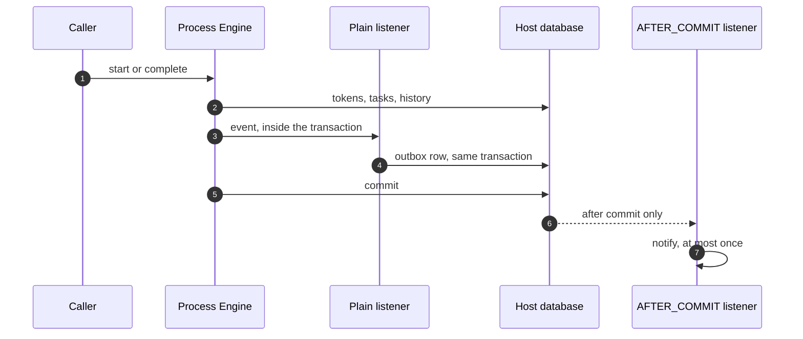

# Process Engine API

Reference for the Process Engine's two surfaces: the in-process Java API and the REST API under `/api/bpm/processes/v1`. The contract file is [`process-engine/api/openapi.yaml`](https://github.com/dhluong90/horus-Agentic-BPM/blob/main/process-engine/api/openapi.yaml).

**Preview in 0.1.0.** The Process Engine ships as a walking skeleton. Outside the `dev` profile an imported definition stays `DRAFT`, and nothing in this release can activate it, because the approval flow comes later. On `dev`, `horus.bpm.processes.definitions.auto-approve` activates imports without approval. Claims, forms, incidents, timers, asynchronous steps and masking of instance variables are not in this release.

## Endpoints

| Method and path | Java | Permission | Notes |
|---|---|---|---|
| `POST /definitions` | `DefinitionService.importDefinition(ImportRequest)` | `processes:deploy` | Body is a BPMN 2.0 document (`application/xml`), UTF-8 only, at most 1 MB. A document identical to the latest version returns that version, also with `201` |
| `POST /instances` | `ProcessEngine.start(StartRequest)` | `processes:start` | Needs a `businessKey` or an `Idempotency-Key` (`428` without either). `201` for a new instance, `200` when one exists for the business key |
| `GET /instances/{id}` | `ProcessEngine.instance(id)` | `processes:read` | Execution tree (root scope token and flow tokens) and tasks; variables unmasked in 0.1.0 |
| `POST /tasks/{id}:complete` | `TaskService.complete(id, result, lockVersion, idempotencyKey)` | `processes:task:work` | `If-Match` (the task's `lockVersion`) and `Idempotency-Key` are required (`428`). The caller must be an assignee; a four-eyes task refuses the starter and earlier completers (`403 SELF_APPROVAL_FORBIDDEN`) |

The tenant always comes from the authenticated caller, never from a body. Every endpoint answers errors as RFC 9457 problem details with a `code`:

| Status | Codes |
|---|---|
| 400 | `INPUT_INVALID` |
| 401 | `UNAUTHENTICATED` |
| 403 | `PERMISSION_DENIED`, `TASK_NOT_ASSIGNED`, `SELF_APPROVAL_FORBIDDEN`, `TENANT_NOT_ALLOWED` |
| 404 | `NO_EFFECTIVE_VERSION`, `INSTANCE_NOT_FOUND`, `TASK_NOT_FOUND` |
| 409 | `VERSION_CONFLICT`, `INVALID_STATE`, `IDEMPOTENCY_IN_FLIGHT` (with `Retry-After: 1`) |
| 413 | `PAYLOAD_TOO_LARGE` |
| 422 | `VALIDATION_FAILED`, `BPMN_UNSUPPORTED_ELEMENT`, `BPMN_UNSAFE_XML`, `DEFINITION_TOO_LARGE`, `IDEMPOTENCY_KEY_REUSE_MISMATCH`, `STEP_FAILED` |
| 428 | `PRECONDITION_REQUIRED` |
| 500 | `INTERNAL`, `DEFINITION_INTEGRITY_FAILED`, `EVENT_LISTENER_FAILED` (correlation id only) |

`BPMN_UNSUPPORTED_ELEMENT` and `VALIDATION_FAILED` carry a `problems` list, each with element, id and line. `STEP_FAILED` carries `nodeId` and `reason` (for example `UNHANDLED_BUSINESS_ERROR`, `DECISION_NO_MATCH`, `STEP_LIMIT`); handler texts stay in the log.

## Transactions

A start or a completion runs every synchronous step, up to the next user task or the end, in the caller's transaction. That covers local service tasks, business rule tasks (one `rle_decision` row each) and gateway conditions. If any step fails, everything rolls back, the host's own writes included. Concurrent requests with one `Idempotency-Key` do the work once: the second waits for the first and replays its answer.

## Events and the listener contract

Every state change hands an event (`processes.instance.started.v1`, `processes.task.created.v1`, `processes.task.completed.v1`, `processes.instance.completed.v1`, `processes.definition.approved.v1`) to the host's `ProcessEventPublisher` **inside the transaction of the state change**. The default implementation is the Spring `ApplicationEventPublisher`. So the event and the state change commit or roll back together.

1. The caller starts an instance or completes a task.
2. The engine writes tokens, tasks and history in the caller's transaction.
3. The engine hands each event to listeners inside that transaction.
4. A durable consumer writes an **outbox row** in that transaction, and the host relays it after commit. This is the only way to use events for money movement, audit or integration between services.
5. The transaction commits.
6. A notification listener uses `@TransactionalEventListener(phase = AFTER_COMMIT)`.
7. It runs at most once, and never for work that rolled back.

A **plain listener** (`@EventListener`) runs inside the engine transaction. It must not do network I/O, and an exception it throws rolls the state change back; the caller gets `500 EVENT_LISTENER_FAILED`. Each publish call is timed, and a listener slower than `handlers.slow-call-warning` (200 ms) is logged at WARN as `process.event.listener.slow` with the event type, instance and duration, never the payload.

Every event carries an envelope `(eventId, type, tenantId, occurredAt, payload)`:

- **Deduplicate on `eventId`.** A host outbox relay delivers at least once. The id is derived from the instance and its sequence, the way the engine derives token ids, so the same transition always carries the same id.
- **Scope by `event.tenantId()`.** The publisher is application-wide and sees every tenant's events. A listener scopes every read and write, and every outbox row, by the envelope's tenant, never by the ambient security context.
- **`AFTER_COMMIT` writes use `REQUIRES_NEW`.** A `REQUIRED` write from an `AFTER_COMMIT` listener joins the finished transaction and is never committed.
- **No variables.** Payloads never carry instance variables or handler output. `businessKey` and the task assignee may be personal data, so a host outbox follows the retention and masking rules of the instance data.
- **Replays publish nothing.** An idempotent replay returns the stored answer without running the work, so no event is published twice. The sample host [`examples/rule-and-process`](https://github.com/dhluong90/horus-Agentic-BPM/blob/main/examples/rule-and-process/README.md) shows both kinds of listener: `ProcessEventOutbox` writes the host's `event_outbox` row and logs after commit.

## Conditions

Gateway conditions use `urn:horus-bpm:expr:v1` and follow the Rule Engine's rules. Null follows FEEL three-valued logic, only a true condition is taken (otherwise the default flow), numbers are decimals, and money compares only within one currency. A type error fails the step. A document whose `expressionLanguage` is another language is refused until that language is supported.
