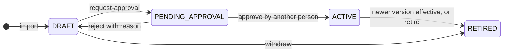
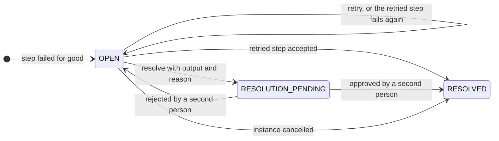
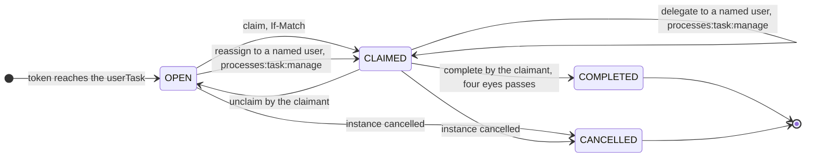
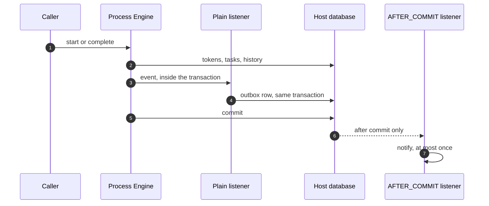

# Process Engine API

Reference for the Process Engine's two surfaces: the in-process Java API and the REST API under `/api/bpm/processes/v1`. The contract file is [`process-engine/api/openapi.yaml`](https://github.com/dhluong90/horus-Agentic-BPM/blob/main/process-engine/api/openapi.yaml).

**Preview.** The Process Engine ships as a walking skeleton (0.1.0) with the read, cancel and task claim endpoints of 0.2.0. An imported definition is a `DRAFT` until a second person approves it (the definition lifecycle, 0.2.0). On `dev`, `horus.bpm.processes.definitions.auto-approve` activates imports without approval. Forms and masking of instance variables are not in this release; incidents are retried and resolved by API since 0.3.0.

**Added in 0.2.0.** The intermediate timer catch event (`timeDuration` or `timeDate`) and replica-safe timer jobs: a timer fires once across copies of the host, and a crashed copy's timers are taken over after the lease (see Process Engine Overview, Timers and jobs with leases).

## Endpoints

| Method and path | Java | Permission | Notes |
|---|---|---|---|
| `POST /definitions` | `DefinitionService.importDefinition(ImportRequest)` | `processes:deploy` | Body is a BPMN 2.0 document (`application/xml`), UTF-8 only, at most 1 MB. A document identical to the latest version returns that version, also with `201` |
| `GET /definitions` | `ProcessQueryService.definitions(PageRequest)` | `processes:read` | One item per key, ordered by key: `latestVersion`, `latestStatus`, `effectiveVersion` (the version a start uses now, or `null`), `lastChangedAt`. Since 0.2.0 |
| `GET /approvals` | `ProcessQueryService.pendingApprovals(PageRequest)` | `processes:read` | The pending approvals queue of the tenant (0.3.0, #31): every definition version waiting for a second person, across all keys and including one that is not the latest, oldest request first, keyset pages with a signed cursor, at most 200. Each item: `key`, `name`, `version`, `definitionHash` (send it back as `expectedDefinitionHash` when you approve), `lockVersion` (send it as `If-Match`), `requestedBy`, `requestedAt`, `allowedActions`, and `deniedActions` for `approve` and `reject` with a reason code: `PERMISSION_REQUIRED` or `SELF_APPROVAL_FORBIDDEN`. Never the definition. |
| `GET /definitions/{key}/versions/{version}` | `DefinitionService.version(key, version)` | `processes:read` | Status, hashes, `approvedBy`, `approvedAt`, `effectiveFrom` and the lifecycle fields (`lockVersion`, `requestedBy`, `retiredBy`, `supersededBy`); no source document. `ETag` is the definition hash; the lifecycle commands take the `lockVersion` field as `If-Match`. This is the `Location` an import returns. `404 DEFINITION_NOT_FOUND`. Since 0.2.0 |
| `GET /definitions/{key}/versions/{version}/export?format=bpmn` | `DefinitionService.exportDefinition(key, version, SourceFormat.BPMN_XML)` | `processes:read` | BPMN 2.0 XML (`application/bpmn+xml`) of the executable subset with a generated diagram layout. Importing it gives the same `definitionHash`, which is also the `ETag`. Read-only. A version of another tenant is `404 DEFINITION_NOT_FOUND`. Since 0.2.0 |
| `GET /definitions/{key}/versions/{version}/diff?base=&limit=&cursor=` | `DefinitionService.diff(base, target)`, `.diffFromEffective(target)`, `.diffPage(base, target, limit, cursor)`, `.diffPageFromEffective(target, limit, cursor)` | `processes:read` | Steps and links added, removed and changed between two stored versions of one key, of any status, so an approver compares a pending version with the effective one before signing. `base` defaults to the effective version (`404 NO_EFFECTIVE_VERSION` without one). Every element carries its BPMN id and readable name; layout and XML are never returned. At most 1,000 changed values, then `truncated: true`. `approvableHash` is the target's `definitionHash` to send on approval; a truncated diff has `approvableHash: null` and no `definitionHash` on either side. With `limit` (1 to 500) or `cursor` the whole change set is read page by page, with the hashes on the last page (see Compare two versions). `ETag` from both definition hashes; `If-None-Match` answers `304`. Another tenant's version is `404 DEFINITION_NOT_FOUND`. Read-only. 0.3.0 |
| `POST /definitions/{key}/versions/{v}:request-approval` | `requestApproval(ref, lockVersion, effectiveFrom, idempotencyKey)` | `processes:author` or `processes:deploy` | `DRAFT` to `PENDING_APPROVAL`; optional `effectiveFrom`, never in the past. `If-Match` required. 0.2.0 |
| `POST /definitions/{key}/versions/{v}:approve` | `approve(ref, lockVersion, expectedDefinitionHash, expectedChangeSetHash, comment, idempotencyKey)` | `processes:approve` | To `ACTIVE`, effective from `effectiveFrom` or now. Body `{"expectedDefinitionHash": "<definitionHash you reviewed>", "expectedChangeSetHash": "<only above 1,000 changes>", "comment": "..."}`. Without the hash `400 CONTENT_HASH_REQUIRED`; when the content changed since you reviewed it `409 CONTENT_CHANGED` with `currentDefinitionHash` (0.3.0, PD-139); when the change list from the effective version is cut off at 1,000 values and you named no `expectedChangeSetHash` `409 CHANGE_SET_TRUNCATED`. An escalation to a role the tenant's `RoleCatalogue` does not list is `422 VALIDATION_FAILED` (`ESCALATION_ROLE_UNKNOWN`). The requester gets `403 SELF_APPROVAL_FORBIDDEN`; an older version than the active one gets `409 VERSION_SUPERSEDED`. 0.2.0 |
| `POST /definitions/{key}/versions/{v}:reject` | `reject(ref, lockVersion, reason, idempotencyKey)` | `processes:approve` | Back to `DRAFT`; `reason` required (`400` without). 0.2.0 |
| `POST /definitions/{key}/versions/{v}:retire` | `retire(ref, lockVersion, reason, confirmNoVersionInEffect, idempotencyKey)` | `processes:approve` (active), `processes:author` (draft) | To `RETIRED`; an active version needs a `reason`; the last version in effect needs `confirmNoVersionInEffect: true` (`409 LAST_VERSION_IN_EFFECT` otherwise); a version a newer version in effect already supersedes is `409 INVALID_STATE`, naming the newer version. Only new starts stop; running instances keep their version. 0.2.0 |
| `GET /definitions/{key}/versions/{v}/history` | `history(ref)` | `processes:read` | Every transition with actor and comment, oldest first. 0.2.0 |
| `POST /instances` | `ProcessEngine.start(StartRequest)` | `processes:start` | Needs a `businessKey` or an `Idempotency-Key` (`428` without either). `201` for a new instance, `200` when one exists for the business key |
| `GET /instances/{id}` | `ProcessEngine.instance(id)` | `processes:read` | Execution tree (root scope token and flow tokens) and tasks; variables unmasked in 0.1.0 |
| `GET /instances/{id}/activities?limit=` | `ProcessQueryService.activities(id, limit)` | `processes:read` | Per step the instance entered: first entered, last completed, the duration between them (null until it completes), attempts, the last actor and its open incident; then the history entries in time order, at most `limit` (200 by default, at most `query.max-page-size`), with `hasMore`. History is read only between the instance's start and end, so PostgreSQL scans only the monthly partitions it lived in. No variable or input value is returned. Entries of a saga's undo (#80) have `kind: COMPENSATION`, and the step they undo (`compensates`), the saga `scope`, the forward `attemptId`, and for a failed one its `errorCode` and `attempt`; the start has the `cause`. `compensations` has one item per saga scope whose undo started, never cut by `limit`: `state` is `UNDONE`, `NOT_FULLY_UNDONE` (an undo step failed for good or waits for a person; `blockedStep`, `incidentId` and `incidentCode` name it) or `IN_PROGRESS`. The `ETag` is a hash of the body; a matching `If-None-Match` gets `304`. Another tenant's instance is `404 INSTANCE_NOT_FOUND`. Since 0.3.0 |
| `GET /definitions/{key}/versions/{version}/node-stats?mode=window&from=&to=` | `ProcessQueryService.nodeWindowStats(key, version, from, to)` | `processes:read` | Counts and typical durations per step over whole hours, from the hourly rollup of the caller's tenant: entered, completed, failed, incidents, mean, median and 95th percentile (each within 19 percent). The range is at most `query.max-range` (31 days, `400 QUERY_INVALID`); the answer names the rollup watermark (`asOf`) and its lag, at most about 10 minutes. Never reads history. Since 0.3.0 |
| `GET /definitions/{key}/versions/{version}/node-stats?mode=live` | `ProcessQueryService.liveNodeCounts(key, version)` | `processes:read` | Live tokens per step and status, with `asOf` and an `ETag`; read from the live token index, never from history. Each replica caches an answer for `stats.live-cache-ttl` (5 s), or `stats.live-cache-ttl-large` (15 s) above `stats.live-cache-large-threshold` (100,000 live tokens). Only `mode=live` (`400` otherwise); a version not in the caller's tenant is `404 DEFINITION_NOT_FOUND`. Open incidents per step follow with incidents. Since 0.2.0 |
| `GET /instances` | `ProcessQueryService.instances(InstanceQuery)` | `processes:read` | `status` (comma separated, `RUNNING` when absent), `definitionKey`, `startedFrom` (inclusive) and `startedTo` (exclusive), at most 31 days apart; with one bound the other is 31 days away. Newest first. Items carry no variables, tokens or tasks. Since 0.2.0 |
| `POST /instances/{id}:cancel` | `ProcessEngine.cancel(id, lockVersion, reason, idempotencyKey)` | `processes:cancel` | Its own permission: `processes:start` does not grant it (PD-103), and `/api/bpm/me` lists it so a client shows Cancel only to its holders. `If-Match` (the instance `ETag`) and `Idempotency-Key` are required (`428`). Body `{"reason": "..."}`, required, at most `lifecycle.reason-max-length` (2,000) characters; the reason and the actor are on the `INSTANCE_ENDED` history entry and on `processes.instance.cancelled.v1`. Cancels every live token and open task; `409 INVALID_STATE` when the instance is not running, and while it is `COMPENSATING`, with a detail that says a compensation is running (#67). Cancel makes no adapter call and runs no compensation; compensation on cancel is planned for 1.2. Since 0.2.0 |
| `POST /async-steps/{jobId}:complete` | `AsyncStepService.complete(jobId, attemptId, completionToken, result)` | `processes:step:complete`, plus a role listed for the step's adapter in `adapters.completer-roles` | Reports the result of a remote step attempt whose `ServiceAdapter` answered `Accepted`, for example a credit bureau calling back. Body `{"attemptId": "...", "completionToken": "...", "status": "COMPLETED", "output": {...}}`, or `"status": "FAILED"` or `"BUSINESS_ERROR"` with `errorCode` (and `retryable` for a failure). The token is the one the adapter received in `AdapterCall.completionToken()`; the attempt id alone is not a credential. Answers `200` with `outcome`: `ACCEPTED` (recorded), `DUPLICATE` (a repeat; nothing written) `DISCARDED` (the lease ended, another attempt took over, or the instance was cancelled; nothing changes in the process) or `REFUSED` (an agent step's answer broke its output schema or guardrail, or the guardrail could not decide; nothing of it is accepted, and the step is retried, goes to a reviewer or fails its job, see [[Process Engine Overview]]). A wrong token, or a caller without a completer role of the adapter, is `403 PERMISSION_DENIED` and nothing is written. A job of another tenant is `404 ASYNC_STEP_NOT_FOUND` and nothing is written. Since 0.2.0 |
| `POST /agent-replays` | `AgentReplayService.start(AgentReplayRequest)` | `processes:agent:replay` | Replays one agent step's recorded answers over a period of at most 31 days against a candidate guardrail version, usually a draft, and an optional candidate output schema. Body `{"definitionKey": "kyc-onboarding", "nodeId": "assess-documents", "from": "2026-11-01", "to": "2026-11-30", "candidate": {"ruleSet": "kyc-document-guardrails", "version": 3}}`. Answers `202` with the queued run; the job poller replays it in pages. Calls no model or adapter and writes no history or decision. See [[Guarded Agent Steps]]. M3 |
| `GET /agent-replays/{id}`, `GET /agent-replays/{id}/cases` | `AgentReplayService.run(id)`, `.cases(id, page)` | `processes:agent:replay` | The run's status and summary, and its report: one line per recorded answer with the attempt id, the recorded and the candidate outcome, the change, the matched rule ids and the `OVERRIDDEN_BY_REVIEWER` flag, never an output value. M3 |
| `GET /agent-replays/{id}/cases/{attemptId}/answer` | `AgentReplayService.recordedAnswer(id, attemptId)` | `processes:agent:replay` | One case's recorded answer as history keeps it: masked output fields as `***`, masked inputs as keyed hashes. M3 |
| `GET /tasks` | `ProcessQueryService.tasks(TaskQuery)` | `processes:task:work`; `assignment=any` also needs `processes:task:manage` | `assignment`: one or more of `mine` (declared to you or claimed by you), `candidate` (open tasks of your roles and groups), `any` (the whole tenant); `mine,candidate` when absent. `status`: `OPEN`, `CLAIMED` or both (default). `role`, `group`: narrow `candidate` and `any` to one role or group (with `mine` alone, `400 QUERY_INVALID`). `dueBefore`, and `slaBreached=true` for tasks whose due time has passed. Ordered by `dueAt`, then `id`; tasks without a due time come last, by `id`. At most 200 per page (`limit` above 200 is `400 QUERY_INVALID`). Items carry no variables and no review context. See [Task lists](#task-lists). Since 0.3.0 |
| `POST /migrations` | `MigrationService.plan(MigrationPlanRequest)` | `processes:migration:manage` | Plans moving the running instances of `sourceVersion` to the active `targetVersion` of one key. Body `{"definitionKey": "loan-review", "sourceVersion": 1, "targetVersion": 2}`; any other field is `400`. Answers `201` with `approval: {"mode": "four-eyes", "secondPersonRequired": true}`: executing the plan will need a second holder of the permission (`single` only on the `dev` profile). Moves nothing. `Idempotency-Key` returns the first plan. A retired target is `409 INVALID_STATE`. 0.3.0 |
| `GET /migrations/{id}` | `MigrationService.find(id)` | `processes:migration:manage` or `processes:read` | The plan. Another tenant's plan is `404 MIGRATION_NOT_FOUND`. 0.3.0 |
| `POST /migrations/{id}:validate` | `MigrationService.validate(id)` | `processes:migration:manage` | Dry run: which running instances would move and which steps have no counterpart in the target. Reads only, needs no approval and no idempotency key. See Migration dry run below. 0.3.0 |
| `POST /migrations/{id}:execute` | `MigrationExecutionService.propose(id, reason, key)` | `processes:migration:manage` | Proposes moving the running instances, with a `reason`. The engine runs the dry run itself; a plan with a conflict is `409 DRY_RUN_REQUIRED`. Answers `202` with the proposal and its `ETag`; nothing moves until a second holder approves. `Idempotency-Key` returns the first answer. 0.3.0 |
| `POST /migrations/{id}:approve` | `MigrationExecutionService.approve(id, lockVersion, key)` | `processes:migration:manage` | A second holder, never the proposer (`403 SELF_APPROVAL_FORBIDDEN`), approves with `If-Match` set to the proposal's `lockVersion`. The dry run is repeated and must still pass and be fresh (`409 DRY_RUN_REQUIRED`). The plan becomes `APPROVED` and the runner moves the instances. 0.3.0 |
| `POST /migrations/{id}:reject` | `MigrationExecutionService.reject(id, lockVersion, reason, key)` | `processes:migration:manage` | A second holder rejects the proposal with a reason; the plan may be proposed again. 0.3.0 |
| `GET /migrations/{id}/execution` | `MigrationExecutionService.execution(id)` | `processes:migration:manage` or `processes:read` | Proposal, approval and exact progress: total, migrated, failed, skipped. 0.3.0 |
| `GET /migrations/{id}/instances?outcome=&after=&limit=` | `MigrationExecutionService.outcomes(id, outcome, after, limit)` | `processes:migration:manage` or `processes:read` | What happened to each instance, in id order; a failure carries its code and its incident id. 0.3.0 |
| `GET /definitions/{key}/versions/{version}/layout?revision=` | `LayoutService.latestLayout(ref)`, `.layoutRevision(ref, n)` | `processes:read` | The diagram layout of a version: the latest revision, or the one named. `ETag` is the revision; a version without a layout answers `204` with `ETag: "0"`. Another tenant's version is `404 DEFINITION_NOT_FOUND`. 0.3.0 |
| `PUT /definitions/{key}/versions/{version}/layout` | `LayoutService.saveLayout(ref, expectedRevision, json, key)` | `processes:author` | Appends a layout revision over the one in `If-Match`. Needs no approval and never changes the definition, its status, hash or lock version. A step id the version lacks is `422 LAYOUT_INVALID`; a stale `If-Match` is `409 VERSION_CONFLICT`. At most 256 KB. 0.3.0 |
| `GET /definitions/{key}/versions/{version}/layout/revisions` | `LayoutService.layoutRevisions(ref, after, limit)` | `processes:read` | Every revision with author and time, oldest first, without the documents. 0.3.0 |
| `GET /incidents?status=OPEN` | `IncidentService.incidents(IncidentQuery)` | `processes:read` | One status (`OPEN` by default, `RESOLUTION_PENDING`, `RESOLVED`), newest first, keyset pages of at most 200. Each item: `errorCode`, `causeSummary`, `retryCount`, `nodeId`, `instanceId`, `retrying`, `pendingResolution` and `allowedActions` for the caller. 0.3.0 |
| `GET /incidents/{id}` | `IncidentService.incident(id)` | `processes:read` | One incident; `ETag` is its `lockVersion`. Another tenant's is `404 INCIDENT_NOT_FOUND`. 0.3.0 |
| `POST /incidents/{id}:retry` | `IncidentService.retry(id, lockVersion, reason, idempotencyKey)` | `processes:incident:manage` | Runs the failed step again: its job is due now with one more attempt under the same job id, or a local step's handler runs again. Body `{"reason": "..."}`. Answers `202`; the incident stays `OPEN` with `retrying: true` until the step is accepted (`RESOLVED`, `RETRY_SUCCEEDED`) or fails again. `If-Match` and `Idempotency-Key` required. 0.3.0 |
| `POST /incidents/{id}:resolve` | `IncidentService.resolve(id, lockVersion, output, reason, idempotencyKey)` | `processes:incident:manage` | Proposes the output the waiting step completes with. Body `{"output": {...}, "reason": "..."}`; the output must pass the step's output schema (`422 OUTPUT_INVALID`). The incident becomes `RESOLUTION_PENDING`; nothing moves until a second person approves. 0.3.0 |
| `POST /incidents/{id}:approve-resolution`, `:reject-resolution` | `approveResolution(id, lockVersion, comment, key)`, `rejectResolution(id, lockVersion, reason, key)` | `processes:incident:manage` | A second person, never the proposer (`403 SELF_APPROVAL_FORBIDDEN`), approves: the step completes with the proposed output and the token moves on (`COMPLETED_MANUALLY`); or rejects with a reason: the incident is `OPEN` again. 0.3.0 |
| `GET /calendars`, `GET /calendars/{key}` | `CalendarService.calendars(page)`, `calendar(key)` | `processes:read` | The tenant's calendars by key (summaries, keyset pages of at most 200), or one calendar with its working hours and holidays and an `ETag` of its version. Another tenant's calendar is `404 CALENDAR_NOT_FOUND`. 0.3.0 |
| `POST /calendars/{key}/changes` | `CalendarService.propose(key, calendar, expectedVersion, reason, idempotencyKey)` | `processes:calendar:manage` | Body `{"calendar": {"zone", "week", "holidays"}, "reason"}`. `If-Match` is the calendar version you read, `"0"` for a new calendar; `Idempotency-Key` is required (`428` without either). `201` with the change, `PENDING` until a second person approves it. The same key with the same request returns the first answer and writes nothing; with another request it is `422 IDEMPOTENCY_KEY_REUSE_MISMATCH`. A stale `If-Match` is `409 VERSION_CONFLICT`. 0.3.0 |
| `GET /calendar-changes?status=PENDING`, `GET /calendar-changes/{id}` | `CalendarService.changes(status, page)`, `change(id)` | `processes:read` | The changes of one status (`PENDING` by default), newest first, each with the old and the new value, the proposer and the decider. 0.3.0 |
| `POST /calendar-changes/{id}:approve`, `:reject` | `CalendarService.approve(id, comment, key)`, `reject(id, comment, key)` | `processes:calendar:manage` | A second person applies the change, or rejects it with a comment (the proposer may withdraw their own). The proposer approving is `403 SELF_APPROVAL_FORBIDDEN`; a change no longer pending is `409 INVALID_STATE`; a calendar that changed since the proposal is `409 VERSION_CONFLICT`. `Idempotency-Key` is required; no `If-Match`. 0.3.0 |
| `GET /tasks/{id}` | `TaskService.task(id)` | `processes:task:work` | The task with its instance, step, assignment, `fourEyes`, claim and completion, `dueAt` (since 0.3.0), and `allowedActions` for this caller (`claim`, `unclaim`, `complete`, and for a holder of `processes:task:manage` `reassign` on an open task or `delegate` on a claimed one). The review task of a refused agent answer also has `review`: the code, reasons, matched rule ids, guardrail decision id, the refused attempt and who reported it, the inputs the agent saw (a masked input as its keyed fingerprint) and the answer masked by the output schema. `ETag` is the task `lockVersion`. Since 0.2.0 |
| `POST /tasks/{id}:claim` | `TaskService.claim(id, lockVersion, idempotencyKey)` | `processes:task:work` | `OPEN` to `CLAIMED` by the caller, who must be an assignee (`403 TASK_NOT_ASSIGNED`); a four-eyes task refuses the starter and earlier completers (`403 SELF_APPROVAL_FORBIDDEN`). `If-Match` and `Idempotency-Key` required (`428`). Since 0.2.0 |
| `POST /tasks/{id}:unclaim` | `TaskService.unclaim(id, lockVersion, idempotencyKey)` | `processes:task:work` | `CLAIMED` to `OPEN`; only the claimant (`403 TASK_NOT_ASSIGNED`). Same headers. Since 0.2.0 |
| `POST /tasks/{id}:reassign` | `TaskService.reassign(id, assignee, reason, lockVersion, idempotencyKey)` | `processes:task:manage` | Body `{"assignee": "dan", "reason": "..."}`, both required, the reason 1 to 500 characters (`400 INPUT_INVALID`). `OPEN` to `CLAIMED` by the named user. `409 ASSIGNEE_NOT_ALLOWED` when the user lacks the task's role or group (asked of the host's `AssigneeDirectory`), started the instance or completed an earlier task of a four-eyes task, or already holds it; a task that is not open, a completed one included, is `409 INVALID_STATE`. History entry `TASK_REASSIGNED` and event `processes.task.reassigned.v1` name the person who moved it, the new holder and the reason. `If-Match` and `Idempotency-Key` required (`428`); a replay returns the first answer. Since 0.3.0 |
| `POST /tasks/{id}:delegate` | `TaskService.delegate(id, assignee, reason, lockVersion, idempotencyKey)` | `processes:task:manage` | As `:reassign`, for a `CLAIMED` task: it stays `CLAIMED`, by the named user. `TASK_DELEGATED` and `processes.task.delegated.v1` also name the previous claimant. Since 0.3.0 |
| `POST /tasks/{id}:complete` | `TaskService.complete(id, result, lockVersion, idempotencyKey)`, or with a `reason` | `processes:task:work` | Body `{"result": {...}, "reason": "..."}`; `reason` is optional and recorded only on the review task of a refused agent answer, with the reviewer's answer and what changed (`HUMAN_OVERRIDE`, since 0.2.0). Only the claimant completes: an `OPEN` task is `409 INVALID_STATE` (claim it first, since 0.2.0), a task claimed by someone else is `403 TASK_NOT_ASSIGNED`. `If-Match` (the task's `lockVersion`) and `Idempotency-Key` are required (`428`). A stale `If-Match` is `409 VERSION_CONFLICT` and writes nothing. A four-eyes task refuses the starter and earlier completers (`403 SELF_APPROVAL_FORBIDDEN`) |

The tenant always comes from the authenticated caller, never from a body; another tenant's definition, instance or task is answered as not found, and nothing is written. Bodies are read and written with the engine's own JSON mapper, so the host's `spring.jackson.*` settings (snake case, dates as timestamps) never change an engine payload: keys are camelCase and times ISO 8601 strings in UTC.

## Lists

Lists are keyset pages:

```json
{ "data": [ { "id": "01JD2X5K9T1Q4N8V2M7B3C6D0E", "definitionKey": "card-fee-review", "status": "RUNNING", "lockVersion": 1, "startedAt": "2027-02-01T09:00:00Z" } ], "nextCursor": "aW5zdGFuY2Vz...", "hasNext": true }
```

`limit` is 1 to `query.max-page-size` (200), 50 when absent. Pass `nextCursor` back unchanged as `cursor`, with the same filters. A cursor is signed for the tenant, the list and its filters, so an edited cursor, one issued to another tenant, or one sent with other filters is `400 QUERY_INVALID`. There is no total count.

| Setting | Default | Meaning |
|---|---|---|
| `horus.bpm.processes.query.max-page-size` | `200` | Most items per page; may be lowered, never raised |
| `horus.bpm.processes.query.max-range` | `P31D` | Longest start-time range of `GET /instances`; may be lowered, never raised |
| `horus.bpm.processes.lifecycle.reason-max-length` | `2000` | Longest cancellation reason; may be lowered, never raised |

The cursor key is one random 32-byte secret per database, in `pre_engine_key`, created at start-up after the migrations. The runtime database user needs `SELECT` and `INSERT` on it.

### Bounded list queries

Every query of the engine store that returns more than one row is registered with its bound (`PRE-036`, ADR-0015): either a page, ordered on an index and ended by `LIMIT`, or the rows of one parent found through an index on its key, such as the tokens of one instance. The build checks this twice. An architecture test fails when a store class reads more than one row outside the registry. The query-plan check runs `EXPLAIN (FORMAT JSON)` for every registered query on a seeded PostgreSQL with sequential scans switched off, and fails on a sequential or whole-index scan of an engine table, on a page without `Limit`, or on a parent-key query whose index condition does not name its key. A `GROUP BY` over a tenant's whole `pre_history` fails both. The check runs in `mvn verify` and in its own workflow, `query-plan.yml`, on PostgreSQL 14 and 18:

```bash
mvn -B -pl process-engine/process-engine-postgres -am test \
  -Dtest='BoundedListQueriesTest,ListQueryPlanCheckTest' -Dsurefire.failIfNoSpecifiedTests=false
```

## Errors

Every endpoint answers errors as RFC 9457 problem details with a `code`:

| Status | Codes |
|---|---|
| 400 | `INPUT_INVALID`, `QUERY_INVALID` |
| 401 | `UNAUTHENTICATED` |
| 403 | `PERMISSION_DENIED`, `TASK_NOT_ASSIGNED`, `SELF_APPROVAL_FORBIDDEN`, `TENANT_NOT_ALLOWED` |
| 404 | `NO_EFFECTIVE_VERSION`, `DEFINITION_NOT_FOUND`, `INSTANCE_NOT_FOUND`, `TASK_NOT_FOUND`, `MIGRATION_NOT_FOUND` |
| 409 | `VERSION_CONFLICT`, `VERSION_SUPERSEDED`, `LAST_VERSION_IN_EFFECT`, `INVALID_STATE`, `IDEMPOTENCY_IN_FLIGHT` (with `Retry-After: 1`) |
| 413 | `PAYLOAD_TOO_LARGE` |
| 422 | `VALIDATION_FAILED`, `BPMN_UNSUPPORTED_ELEMENT`, `BPMN_UNSAFE_XML`, `DEFINITION_TOO_LARGE`, `IDEMPOTENCY_KEY_REUSE_MISMATCH`, `STEP_FAILED` |
| 428 | `PRECONDITION_REQUIRED` |
| 500 | `INTERNAL`, `DEFINITION_INTEGRITY_FAILED`, `EVENT_LISTENER_FAILED` (correlation id only) |

A request the framework refuses before the engine runs (an unreadable body, an unsupported media type) keeps its 4xx status with code `INPUT_INVALID`. `403 TENANT_NOT_ALLOWED` and `401 UNAUTHENTICATED` from the host contract carry the host's correlation id and, on a `401`, the `WWW-Authenticate` challenge. No body ever carries a stack trace, a class name or SQL.

`BPMN_UNSUPPORTED_ELEMENT` and `VALIDATION_FAILED` carry a `problems` list, each with element, id and line. `STEP_FAILED` carries `nodeId` and `reason` (for example `DECISION_NO_MATCH`, `STEP_LIMIT`); handler texts stay in the log. A handler's business error is not a `STEP_FAILED`: the call succeeds, and the step waits with an incident `UNHANDLED_BUSINESS_ERROR` (#55).

## Definition lifecycle (0.2.0)

An import is a `DRAFT` and never the effective version. A person with `processes:author` or `processes:deploy` requests approval, optionally with `effectiveFrom`; a second person with `processes:approve` approves it. The approver must differ from every maker of the version: the importer and the requester (and every editor once draft editing exists); the shared host setting `horus.bpm.lifecycle.approver-must-differ-from: requester` relaxes this to the requester only, and is reported in `/api/bpm/meta` and on every approval. The requester can never approve, through Java or REST, and nothing is written when refused. The requester cannot reject their own request either (`403 SELF_APPROVAL_FORBIDDEN`); withdraw comes later. The approved version is the effective one from its `effectiveFrom`; at that time each older active version is retired once (`retiredBy: system:effective-date`, `supersededBy`), by a job that runs on whichever copy of the host claims it. Instances keep the version they started on. A reject needs a reason and returns the version to `DRAFT`. Each transition writes a history row and publishes `processes.definition.publish-requested.v1`, `approved.v1`, `rejected.v1` or `retired.v1` inside its transaction.



Retiring an active version needs `processes:approve` and a reason, in the `single` mode of the shared host setting `horus.bpm.lifecycle.retire-approval`; the history row and `retired.v1` record the mode. It stops new starts only; running instances keep their version. Retiring the last version in effect of a key follows `horus.bpm.lifecycle.retire-last-version`: `confirm` (default) needs `confirmNoVersionInEffect: true`, `refuse` never allows it. A version that a newer version in effect already supersedes, while its effective-date job has not run yet, cannot be retired by hand (`409 INVALID_STATE`, naming the newer version): the job retires it as `system:effective-date`, as the Rule Engine does. The `four-eyes` value of either setting is refused at start-up in this release.

An approval names the content the approver reviewed (0.3.0, PD-139): send `expectedDefinitionHash`, the `definitionHash` shown with the version. Without it the approval is `400 CONTENT_HASH_REQUIRED`; when the stored content is no longer what you reviewed it is `409 CONTENT_CHANGED` with the current hash, and nothing is written. A change list between two versions that was cut off at its limit has no hash to approve (`approvableHash: null`), and an approval of a version whose change list from the effective version is cut off is `409 CHANGE_SET_TRUNCATED`. A version with more than 1,000 changed values is approved after the whole change set was read page by page: the last page carries `changeSetHash`, and sending it as `expectedChangeSetHash` next to `expectedDefinitionHash` approves the version, also outside `dev`; a hash that is not the hash of the change set now is `409 CONTENT_CHANGED` with `currentChangeSetHash`. The history row and the approved event record `reviewedChangeSetHash`.

When the host registers a `RoleCatalogue`, request-approval and approval check that every `role:` an escalation names exists in the caller's tenant: otherwise `422 VALIDATION_FAILED` with a problem `ESCALATION_ROLE_UNKNOWN` naming the step and the role, and nothing is written. Without a catalogue no role is checked; outside `dev` the host logs a warning at start-up.

`GET /approvals` lists the versions that wait for you (0.3.0, #31). The requester gets neither `approve` nor `reject`; under the default `approver-must-differ-from: makers` the importer or creator may reject but not approve. The list needs only `processes:read`, so a reviewer sees why a button is missing; the commands still decide.

Outside the `dev` profile the starter refuses `definitions.auto-approve: true`, `maker-checker.enabled: false` and `approval.require-content-hash: false`, and on every profile it refuses the removed key `definitions-auto-approve`.

## Incidents (0.3.0)

A step that fails for good opens an incident and the token waits on the step. An operator with `processes:incident:manage` fixes it through the API:

- **Retry** runs the same step again. A remote or agent step keeps its job id, which the remote side uses to deduplicate, and gets a new attempt id; an agent's answer is checked again. A local step's handler runs again at once. A retry is one person's action because it decides nothing.
- **Resolve** proposes the output the step completes with, with a reason. The output must pass the step's output schema; the guardrail is not run on a person's answer. A second holder of `processes:incident:manage`, never the proposer, approves it, and only then does the token move on; or rejects it, and the incident is open again (PD-126). `horus.bpm.processes.incidents.resolve-approval: single` lets one person resolve, on the `dev` profile only.
- **Cancel** of the instance resolves its incidents as `INSTANCE_CANCELLED`.

Every command needs `If-Match` (the incident's `lockVersion`) and an `Idempotency-Key`, writes nothing when refused, and is recorded in history with the actor and the reason: `INCIDENT_RETRIED`, `INCIDENT_RESOLUTION_PROPOSED`, `INCIDENT_RESOLUTION_REJECTED`, `INCIDENT_RESOLVED`. The events are `processes.incident.retried.v1`, `.resolution-proposed.v1`, `.resolution-rejected.v1` and `.resolved.v1` (with `resolution`, `resolvedBy` and `proposedBy`).



## Task lifecycle



Every change carries the task's `lockVersion` as `If-Match` and advances it by one: a claim of a task at `"0"` answers `ETag: "1"`, which the completion then sends. Two officers who read the same version and act at once get one `200` and one `409 VERSION_CONFLICT`, and only one transition and history entry is written. Read `GET /tasks/{id}` for the current `ETag` and the actions this caller may take.

## Task lists

A team lead and an officer see their queues from `GET /tasks`. Example: Minh holds the roles `credit-officer` and `ops` and the group `branch-hcm-01`.

```
GET /api/bpm/processes/v1/tasks?assignment=candidate&limit=50          # open tasks of both roles and the group
GET /api/bpm/processes/v1/tasks?assignment=candidate&slaBreached=true  # the ones already late
GET /api/bpm/processes/v1/tasks?assignment=mine                        # the ones he claimed
```

```json
{
  "data": [
    {"id": "01JD2R7Q4M8S3N6V0B5C9X1Z2A", "instanceId": "01JD2R7Q0D3F6H9K2M5P8R1T4V",
     "definitionKey": "loan-credit-review", "definitionVersion": 2, "businessKey": "LN-2027-000123",
     "nodeId": "credit-review", "name": "Credit review", "assignee": "role:credit-officer",
     "status": "OPEN", "lockVersion": 0, "claimedBy": null,
     "createdAt": "2026-12-31T08:00:00Z", "dueAt": "2027-01-04T03:00:00Z"}
  ],
  "nextCursor": "eyJ...",
  "hasNext": true
}
```

Each range (your user, your claims, each role, each group) is read through its own index for one page and the pages are merged, so a queue of 30,000 tasks answers as fast as one of 30. Pass `nextCursor` back as `cursor`; it is signed for your tenant and these filters, so another tenant's cursor, or one from other filters, is `400 QUERY_INVALID`.


## Due times on working hours

A user task with `horus:sla` is due after that much working time in the tenant's calendar named by `horus:calendar`:

```xml
<bpmn:userTask id="credit-review" name="Credit review" horus:assignee="role:credit-officer"
               horus:resultVariable="review" horus:sla="PT4H" horus:calendar="vn-banking-hours"/>
```

With `vn-banking-hours` set to Monday to Friday 08:00 to 17:00 Asia/Ho_Chi_Minh and 1 January 2027 off, a task created on Thursday 31 December 2026 at 15:00 +07:00 is due on Monday 4 January 2027 at 10:00 +07:00: two hours count on Thursday, Friday is a holiday, the weekend is skipped, and two more hours count on Monday. The due time is set once, with the engine clock, and is never moved by a later calendar change. Without `horus:calendar` the SLA counts elapsed time. A calendar your tenant does not have fails the step (`422 STEP_FAILED`, reason `CALENDAR_NOT_FOUND`) and nothing is written.

Calendars are stored per tenant and changed through `CalendarService` in Java: a holder of `processes:calendar:manage` proposes the whole calendar, with a reason, against the version they read (0 for a new one); a second holder approves it. The proposer cannot approve (`403 SELF_APPROVAL_FORBIDDEN`), and an approval over a calendar that changed since the proposal is `409 VERSION_CONFLICT`. The approval emits `processes.calendar.changed.v1` naming both people, and the change record keeps the old and the new value. `horus.bpm.processes.calendar.approval: single` lets one person apply a change and is accepted only in the `dev` profile. The calendar endpoints are in the table above, and the cockpit editor follows in a later release. A host that keeps calendars in its own system registers a `BusinessCalendar` bean instead.

An overdue task can be escalated. A user task with `horus:sla` may add `horus:escalation`, up to three levels separated by `;`, each a target (`user:`, `role:` or `group:`) with an optional wait after `|`, and `horus:onClaimed`:

```xml
<bpmn:userTask id="review-application" horus:assignee="role:credit-officer" horus:fourEyes="true"
               horus:resultVariable="review" horus:sla="PT8H" horus:calendar="vn-banking-hours"
               horus:escalation="role:branch-supervisor;role:regional-manager|PT4H" horus:onClaimed="release"/>
```

Created on Thursday 3 December 2026 at 15:00 +07:00, this task is due on Friday 4 December at 14:00 and moves to the branch supervisor then. The second level waits 4 more working hours: 3 on Friday and 1 on Monday, so it fires on Monday 7 December at 09:00, not on Saturday. The times are worked out once when the task is created, so a later calendar change moves none of them. With `release`, the default, a claimed task goes back to `OPEN` for the new assignment and the event names the released claimant; with `keep` the claimant keeps it and still completes it. Four eyes holds at every level: whoever started the case or completed an earlier task still cannot claim it. A level that names such a person is not applied: history records `ESCALATION_REFUSED` and an incident `ESCALATION_TARGET_FORBIDDEN` opens. Each replica's job poller runs the sweep, a bounded read of at most `jobs.batch-size` due tasks across tenants, and a level is applied once however many replicas run it. The host sends the notification from `processes.task.escalated.v1` (`taskId`, `instanceId`, `nodeId`, `level`, `from`, `to`).


## Live counts per step

Example: three card applications wait for an officer.

```
GET /api/bpm/processes/v1/definitions/card-fee-review/versions/1/node-stats?mode=live

200 {"definitionKey":"card-fee-review","version":1,"mode":"live","asOf":"2026-11-20T09:30:00Z",
     "nodes":{"officer-review":{"WAITING_USER":3}}}
```

## Compare two versions

Example: v2 of KYC onboarding adds a fraud check and gives the approval to a credit officer.

```
GET /api/bpm/processes/v1/definitions/kyc-onboarding/versions/2/diff?base=1

200 {"definitionKey":"kyc-onboarding","identical":false,
     "nodesAdded":[{"id":"fraud-check","name":"Fraud check","type":"serviceTask"}],
     "nodesRemoved":[],
     "nodesChanged":[{"id":"approve","name":"Approve","type":"userTask","path":"/assignee/role","from":"ops","to":"credit-officer"}],
     "edgesAdded":[{"id":"fraud__approve","from":"fraud-check","to":"approve","kind":"next",...},
                   {"id":"verify__fraud","from":"verify-docs","to":"fraud-check","kind":"next",...}],
     "edgesRemoved":[{"id":"verify__approve","from":"verify-docs","to":"approve","kind":"next",...}],
     "truncated":false, ...}
```

Steps are matched by BPMN id and compared on the canonical form that is hashed and approved; `path` is a JSON Pointer inside the step, so a changed branch condition is `/branches/0/when` on its gateway. Links are matched by `(from, to, kind)`, with kind `next`, `branch[i]`, `default` or `fork`. Moving boxes changes nothing. The same two versions always give the same body.

### A change set of more than 1,000 changes

Add `limit` or `cursor` to read every change, a page at a time, in a fixed order (steps added, steps removed, changed values, links added, links removed). Example: 1,200 changed values at `limit=500`.

```
GET .../definitions/kyc-onboarding/versions/2/diff?limit=500
200 {... "truncated":false, "approvableHash":null, "changeSetHash":null,
     "page":{"offset":0,"total":1200,"nextCursor":"NTAwOjc2..."}}      (no definitionHash on either side yet)

GET .../diff?limit=500&cursor=NTAwOjc2...    (twice more; the last page has "page":{"offset":1000,"total":1200,"nextCursor":null})
200 {... "base":{"version":1,"status":"ACTIVE","definitionHash":"3f1c..."}, "target":{...,"definitionHash":"9a8b..."},
     "approvableHash":"9a8b...", "changeSetHash":"c71e..."}

POST .../versions/2:approve   {"expectedDefinitionHash":"9a8b...","expectedChangeSetHash":"c71e..."}
```

The hashes appear on the last page only, and each cursor carries a digest of the changes before it, so they come from reading every page in order. `changeSetHash` covers both definition hashes and every change; it is the same whatever the page size. If the version or the effective version changes before you approve, the approval is `409 CONTENT_CHANGED` with `currentChangeSetHash`: read the pages again. A cursor this change set did not issue is `400 QUERY_INVALID`.

## Migration dry run

Example: 500 loans run on `loan-review` v1; v2 removes the step `legacy-review`, where 50 of them wait.

```
POST /api/bpm/processes/v1/migrations            {"definitionKey":"loan-review","sourceVersion":1,"targetVersion":2}
201 {"id":"01J...","status":"PLANNED","approval":{"mode":"four-eyes","secondPersonRequired":true},"planHash":"..."}

POST /api/bpm/processes/v1/migrations/01J...:validate
200 {"valid":false,"instances":{"running":500,"movable":450,"blocked":50},
     "conflicts":[{"code":"STEP_NOT_IN_TARGET","nodeId":"legacy-review","name":"Legacy committee review",
                   "instances":{"count":50,"instanceIds":["01J..."],"truncated":false}}],
     "movable":{"count":450,"instanceIds":["01J...", "... 100 ids"],"truncated":true},
     "checkedAt":"2027-03-01T02:00:00Z","validUntil":"2027-03-01T03:00:00Z", ...}
```

Every step of the source version that holds live tokens maps by identical id: `SAME_ID`, `STEP_NOT_IN_TARGET`, or `STEP_TYPE_CHANGED` when the id is kept for another kind of step. A target that is no longer active is `TARGET_NOT_ACTIVE`. The dry run writes nothing, so running it again is always safe. Executing the plan is described under Migration execution below.

| Setting | Default | Meaning |
|---|---|---|
| `horus.bpm.processes.migration.approval` | `four-eyes` | The approval a new plan records for its execution. `single` is accepted only when the `dev` profile is active on its own; start-up is refused otherwise |
| `horus.bpm.processes.migration.dry-run-sample-size` | `100` | Most instance ids listed per conflict and for the instances that would move, 1 to 500; may be lowered only |
| `horus.bpm.processes.migration.dry-run-validity` | `PT1H` | How long an execution may rely on a dry run; at most one hour, may be lowered only |

## Migration execution

A plan moves instances only after two people have said so, and only in bounded batches. Example: the plan above, with the 50 loans at `legacy-review` first sent on to `review`.

```
POST /api/bpm/processes/v1/migrations/01J...:execute   {"reason":"Add the audit sample after officer review, change CHG-2041"}
202 {"status":"PROPOSED","lockVersion":1,"proposedBy":"thu","progress":{"total":500,"migrated":0,"failed":0,"skipped":0}, ...}

POST /api/bpm/processes/v1/migrations/01J...:approve   If-Match: "1"        (a second holder; thu gets 403 SELF_APPROVAL_FORBIDDEN)
200 {"status":"APPROVED","approvedBy":"lan", ...}

GET /api/bpm/processes/v1/migrations/01J.../execution
200 {"status":"COMPLETED_WITH_FAILURES","progress":{"total":500,"migrated":499,"failed":1,"skipped":0}, ...}

GET /api/bpm/processes/v1/migrations/01J.../instances?outcome=FAILED
200 {"items":[{"instanceId":"01J...","outcome":"FAILED","code":"STEP_NOT_IN_TARGET","incidentId":"01J...", ...}],"nextAfter":null}
```

- The engine runs the dry run itself, when the plan is proposed and again when it is approved; the proposal's dry run must be no older than `migration.dry-run-validity`. A plan with a conflict, or a stale dry run, is `409 DRY_RUN_REQUIRED` and nothing is written.
- Only the approval makes the plan runnable. The table refuses a running plan without an approver and a four-eyes approval by the proposer. With `migration.approval=single` (the `dev` profile only) the proposer's proposal is approved at once and the history records `single`.
- A runner on each replica takes one approved plan at a time under a lease and moves its instances in batches of `migration.batch-size`, one instance lock at a time. Each moved instance has its row, tokens, open tasks, due jobs and recorded results pointed at the target version, and one `MIGRATED` history row naming the approver, the proposer and the reason. The cursor and the counts are committed with each instance, so a crashed replica's plan is taken over when its lease ends and continues after the last moved instance. Nothing is moved twice.
- An instance that cannot move (a step the target does not keep, or a row another transaction holds) stays on its version, gets an incident `MIGRATION_FAILED` and an outcome `FAILED`; the rest go on. The plan ends `COMPLETED`, or `COMPLETED_WITH_FAILURES` with an incident for each failure.
- The runner runs inside the job poller, so `jobs.enabled=false` also stops it.

| Setting | Default | Meaning |
|---|---|---|
| `horus.bpm.processes.migration.batch-size` | `100` | Instances the runner reads at a time, 1 to 100; may be lowered only |
| `horus.bpm.processes.migration.lease` | `PT2M` | How long a runner holds a plan without renewing it, `PT10S` to `PT10M`; it renews after every instance |

## Diagram layout

The position of boxes on a diagram is stored apart from the definition. `PUT .../layout` appends a revision with `If-Match` set to the revision the client saw (`"0"` when there is none). It needs `processes:author` and no approval, because a layout cannot change behaviour: the version's `definitionHash`, status and `lockVersion` stay as they were, so tidying a diagram needs no new approval. Revisions are never changed or deleted and each records who saved it and when. A layout may list only some of the steps; the cockpit places the rest. A step that is not in the definition is `422 LAYOUT_INVALID` with each problem in `paths`. The layout of another tenant's version is `404 DEFINITION_NOT_FOUND`.

```
PUT /api/bpm/processes/v1/definitions/kyc-onboarding/versions/2/layout     If-Match: "3"
    {"schemaVersion":1,"nodes":{"start":{"x":40,"y":120},"verify-docs":{"x":200,"y":100,"width":140,"height":80}}}
200 {"revision":4,"createdBy":"carol","definitionHash":"9a8b...","layoutHash":"c41e...", ...}     ETag: "4"
```

## Hourly figures per step

Example: the same version over one hour, from the rollup.

```
GET /api/bpm/processes/v1/definitions/card-fee-review/versions/1/node-stats?mode=window&from=2026-11-20T10:00:00Z&to=2026-11-20T11:00:00Z

200 {"definitionKey":"card-fee-review","version":1,"mode":"window","from":"2026-11-20T10:00:00Z","to":"2026-11-20T11:00:00Z",
     "asOf":"2026-11-20T10:50:00Z","lagSeconds":600,
     "nodes":{"officer-review":{"entered":1200,"completed":1200,"failed":0,"incidents":0,"slaBreaches":0,
                                "meanMs":5400000,"p50Ms":4800000,"p95Ms":9900000}}}
```

The rollup runs on every replica that has `stats.rollup-enabled` (the default). Replicas take turns: one writer takes each slice of history, so two replicas never count the same stretch twice.

Two settings keep the figures safe and small. `stats.rollup-min-lag` (default `PT5M`) is the write-lag window: the longest a step transaction may stay open before its history row commits. The rollup never rolls up history newer than `stats.rollup-lag` ago, and start-up is refused when that is shorter than the window (a window below `PT5M` is accepted on the `dev` profile only). `stats.rollup-retention` (default `P13M`, an ISO-8601 period of at least `P31D`) is how long hourly rows are kept: the rollup run deletes older whole days, 5,000 rows at a time and at most 20 batches per run, so a first purge after an upgrade spreads over several runs. `pre_history` is the audit record and is not touched.

## Export a definition as BPMN

The export writes a stored version as BPMN 2.0 XML that standard modellers open, and that imports back to the same definition:

```bash
curl -u lan:$HORUS_DEMO_PASSWORD -o card-fee-review-v1.bpmn -D - \
  "http://localhost:8080/api/bpm/processes/v1/definitions/card-fee-review/versions/1/export?format=bpmn"
# HTTP/1.1 200, Content-Type: application/bpmn+xml, ETag: "<definitionHash of v1>"

curl -u lan:$HORUS_DEMO_PASSWORD -H 'Content-Type: application/bpmn+xml' \
  --data-binary @card-fee-review-v1.bpmn http://localhost:8080/api/bpm/processes/v1/definitions
# 201 with version 1 and the same definitionHash: no new version is created
```

What the file holds:

- The process with its steps, flows, conditions and the `horus` attributes (`horus:handler`, `horus:ruleSet`, `horus:assignee`, `horus:fourEyes`, `horus:resultVariable`, `horus:input`), with `incoming` and `outgoing` on every node. It validates against the BPMN 2.0 XSD.
- A generated left-to-right diagram, not the layout of the file that was imported. Layout is not part of the definition hash.
- No vendor extensions of the imported file. They are never executed and are not part of the definition.

Only the executable subset the import accepts can be exported in this release. Agent steps (`horus:type="agentTask"`) are exported with their `<horus:outputSchema>` and `<horus:guardrail>` since 0.2.0; A definition with a `saga` block (#67) is imported and run, and is not yet exported back to BPMN.

## Transactions

A start or a completion runs every synchronous step, up to the next user task or the end, in the caller's transaction. That covers local service tasks, business rule tasks (one `rle_decision` row each) and gateway conditions. If any step fails, everything rolls back, the host's own writes included. Concurrent requests with one `Idempotency-Key` do the work once: the second waits for the first and replays its answer.

## Events and the listener contract

Every state change hands an event (`processes.instance.started.v1`, `processes.step.completed.v1`, `processes.incident.raised.v1`, `processes.task.created.v1`, `processes.task.completed.v1`, `processes.instance.completed.v1`, `processes.instance.cancelled.v1`, `processes.task.claimed.v1`, `processes.task.unclaimed.v1`, `processes.task.escalated.v1`, `processes.definition.publish-requested.v1`, `processes.definition.approved.v1`, `processes.definition.rejected.v1`, `processes.definition.retired.v1`) to the host's `ProcessEventPublisher` **inside the transaction of the state change**. The default implementation is the Spring `ApplicationEventPublisher`. So the event and the state change commit or roll back together.

Each event is in the standard envelope: `eventId`, `eventType`, `occurredAt`, `tenantId`, `correlationId` (the request's `X-Correlation-Id`), `causationId` (its `Idempotency-Key`, or the job id), `producer`, `schemaVersion` and `payload`. The payload holds ids, keys, versions and codes, never a variable. The JSON Schema of each type is in `process-engine/api/events/`, and a change within `.v1` only adds. `Event.envelope()` gives the map to write into a host outbox row.

## Metrics

With Micrometer on the classpath, the starter registers `horus.pre.instances.started|completed|failed`, `horus.pre.incidents.raised{errorCode}`, `horus.pre.instances.active`, `horus.pre.incidents.open`, `horus.pre.timer.lag`, `horus.pre.step.duration{stepKind,outcome}`, `horus.pre.async.attempts{kind,outcome}` and `horus.pre.jobs.due.oldest.age{kind}`. Counters move after commit only. Tags take engine values only, never a tenant, business key, instance id or variable; `definitionKey` is a tag only with `horus.bpm.processes.metrics.definition-key-tag=true`. Gauges are read once per `metrics.gauge-refresh` (30 s) on each replica, not per scrape. CI publishes a throughput report against the target of 1,000 transitions per second; it is reported, never a gate.



1. The caller starts an instance or completes a task.
2. The engine writes tokens, tasks and history in the caller's transaction.
3. The engine hands each event to listeners inside that transaction.
4. A durable consumer writes an **outbox row** in that transaction, and the host relays it after commit. This is the only way to use events for money movement, audit or integration between services.
5. The transaction commits.
6. A notification listener uses `@TransactionalEventListener(phase = AFTER_COMMIT)`.
7. It runs at most once, and never for work that rolled back.

A **plain listener** (`@EventListener`) runs inside the engine transaction. It must not do network I/O, and an exception it throws rolls the state change back; the caller gets `500 EVENT_LISTENER_FAILED`. Each publish call is timed, and a listener slower than `handlers.slow-call-warning` (200 ms) is logged at WARN as `process.event.listener.slow` with the event type, instance and duration, never the payload.

Every event carries an envelope `(eventId, type, tenantId, occurredAt, payload)`:

- **Deduplicate on `eventId`.** A host outbox relay delivers at least once. The id is derived from the instance and its sequence, the way the engine derives token ids, so the same transition always carries the same id.
- **Scope by `event.tenantId()`.** The publisher is application-wide and sees every tenant's events. A listener scopes every read and write, and every outbox row, by the envelope's tenant, never by the ambient security context.
- **`AFTER_COMMIT` writes use `REQUIRES_NEW`.** A `REQUIRED` write from an `AFTER_COMMIT` listener joins the finished transaction and is never committed.
- **No variables.** Payloads never carry instance variables or handler output. `businessKey` and the task assignee may be personal data, so a host outbox follows the retention and masking rules of the instance data.
- **Replays publish nothing.** An idempotent replay returns the stored answer without running the work, so no event is published twice. The sample host [`examples/rule-and-process`](https://github.com/dhluong90/horus-Agentic-BPM/blob/main/examples/rule-and-process/README.md) shows both kinds of listener: `ProcessEventOutbox` writes the host's `event_outbox` row and logs after commit.

## Conditions

Gateway conditions use `urn:horus-bpm:expr:v1` and follow the Rule Engine's rules. Null follows FEEL three-valued logic, only a true condition is taken (otherwise the default flow), numbers are decimals, and money compares only within one currency. A type error fails the step. A document whose `expressionLanguage` is another language is refused until that language is supported.
