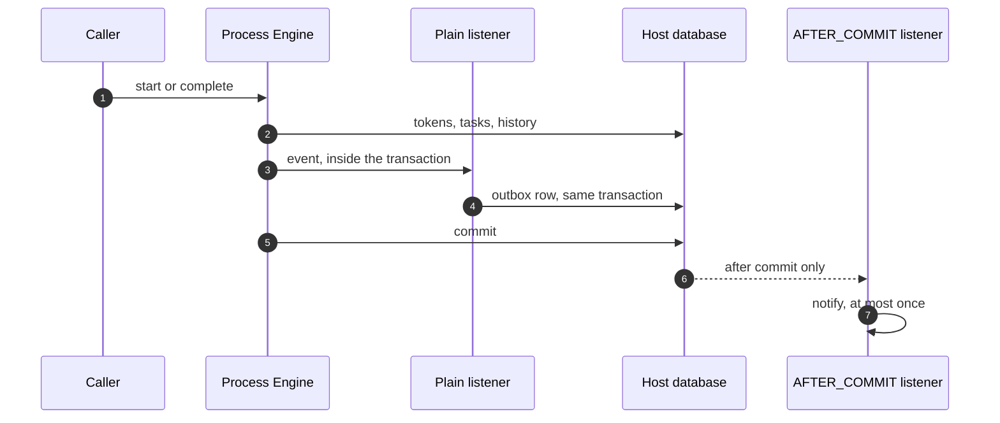

# Process Engine API

Reference for the Process Engine's two surfaces: the in-process Java API and the REST API under `/api/bpm/processes/v1`. The contract file is [`process-engine/api/openapi.yaml`](https://github.com/dhluong90/horus-Agentic-BPM/blob/main/process-engine/api/openapi.yaml).

**Preview.** The Process Engine ships as a walking skeleton (0.1.0) with the read and cancel endpoints of 0.2.0. Outside the `dev` profile an imported definition stays `DRAFT`, and nothing in this release can activate it, because the approval flow comes later. On `dev`, `horus.bpm.processes.definitions.auto-approve` activates imports without approval. Claims, forms, incidents, timers, asynchronous steps and masking of instance variables are not in this release.

## Endpoints

| Method and path | Java | Permission | Notes |
|---|---|---|---|
| `POST /definitions` | `DefinitionService.importDefinition(ImportRequest)` | `processes:deploy` | Body is a BPMN 2.0 document (`application/xml`), UTF-8 only, at most 1 MB. A document identical to the latest version returns that version, also with `201` |
| `GET /definitions` | `ProcessQueryService.definitions(PageRequest)` | `processes:read` | One item per key, ordered by key: `latestVersion`, `latestStatus`, `effectiveVersion` (the version a start uses now, or `null`), `lastChangedAt`. Since 0.2.0 |
| `GET /definitions/{key}/versions/{version}` | `DefinitionService.version(key, version)` | `processes:read` | Status, hashes, `approvedBy`, `approvedAt`, `effectiveFrom`; no source document. `ETag` is the definition hash. This is the `Location` an import returns. `404 DEFINITION_NOT_FOUND`. Since 0.2.0 |
| `POST /instances` | `ProcessEngine.start(StartRequest)` | `processes:start` | Needs a `businessKey` or an `Idempotency-Key` (`428` without either). `201` for a new instance, `200` when one exists for the business key |
| `GET /instances/{id}` | `ProcessEngine.instance(id)` | `processes:read` | Execution tree (root scope token and flow tokens) and tasks; variables unmasked in 0.1.0 |
| `GET /instances` | `ProcessQueryService.instances(InstanceQuery)` | `processes:read` | `status` (comma separated, `RUNNING` when absent), `definitionKey`, `startedFrom` (inclusive) and `startedTo` (exclusive), at most 31 days apart; with one bound the other is 31 days away. Newest first. Items carry no variables, tokens or tasks. Since 0.2.0 |
| `POST /instances/{id}:cancel` | `ProcessEngine.cancel(id, lockVersion, reason, idempotencyKey)` | `processes:cancel` | Its own permission: `processes:start` does not grant it (PD-103), and `/api/bpm/me` lists it so a client shows Cancel only to its holders. `If-Match` (the instance `ETag`) and `Idempotency-Key` are required (`428`). Body `{"reason": "..."}`, required, at most `lifecycle.reason-max-length` (2,000) characters; the reason and the actor are on the `INSTANCE_ENDED` history entry and on `processes.instance.cancelled.v1`. Cancels every live token and open task; `409 INVALID_STATE` when the instance is not running. Cancel makes no adapter call and runs no compensation in 0.2.0; compensation on cancel is planned for 1.2. Since 0.2.0 |
| `POST /tasks/{id}:complete` | `TaskService.complete(id, result, lockVersion, idempotencyKey)` | `processes:task:work` | `If-Match` (the task's `lockVersion`) and `Idempotency-Key` are required (`428`). The caller must be an assignee; a four-eyes task refuses the starter and earlier completers (`403 SELF_APPROVAL_FORBIDDEN`) |

The tenant always comes from the authenticated caller, never from a body; another tenant's definition, instance or task is answered as not found, and nothing is written. Bodies are read and written with the engine's own JSON mapper, so the host's `spring.jackson.*` settings (snake case, dates as timestamps) never change an engine payload: keys are camelCase and times ISO 8601 strings in UTC.

## Lists

Lists are keyset pages:

```json
{ "data": [ { "id": "01JD2X5K9T1Q4N8V2M7B3C6D0E", "definitionKey": "card-fee-review", "status": "RUNNING", "lockVersion": 1, "startedAt": "2027-02-01T09:00:00Z" } ], "nextCursor": "aW5zdGFuY2Vz...", "hasNext": true }
```

`limit` is 1 to `query.max-page-size` (200), 50 when absent. Pass `nextCursor` back unchanged as `cursor`, with the same filters. A cursor is signed for the tenant, the list and its filters, so an edited cursor, one issued to another tenant, or one sent with other filters is `400 QUERY_INVALID`. There is no total count.

| Setting | Default | Meaning |
|---|---|---|
| `horus.bpm.processes.query.max-page-size` | `200` | Most items per page; may be lowered, never raised |
| `horus.bpm.processes.query.max-range` | `P31D` | Longest start-time range of `GET /instances`; may be lowered, never raised |
| `horus.bpm.processes.lifecycle.reason-max-length` | `2000` | Longest cancellation reason; may be lowered, never raised |

The cursor key is one random 32-byte secret per database, in `pre_engine_key`, created at start-up after the migrations. The runtime database user needs `SELECT` and `INSERT` on it.

## Errors

Every endpoint answers errors as RFC 9457 problem details with a `code`:

| Status | Codes |
|---|---|
| 400 | `INPUT_INVALID`, `QUERY_INVALID` |
| 401 | `UNAUTHENTICATED` |
| 403 | `PERMISSION_DENIED`, `TASK_NOT_ASSIGNED`, `SELF_APPROVAL_FORBIDDEN`, `TENANT_NOT_ALLOWED` |
| 404 | `NO_EFFECTIVE_VERSION`, `DEFINITION_NOT_FOUND`, `INSTANCE_NOT_FOUND`, `TASK_NOT_FOUND` |
| 409 | `VERSION_CONFLICT`, `INVALID_STATE`, `IDEMPOTENCY_IN_FLIGHT` (with `Retry-After: 1`) |
| 413 | `PAYLOAD_TOO_LARGE` |
| 422 | `VALIDATION_FAILED`, `BPMN_UNSUPPORTED_ELEMENT`, `BPMN_UNSAFE_XML`, `DEFINITION_TOO_LARGE`, `IDEMPOTENCY_KEY_REUSE_MISMATCH`, `STEP_FAILED` |
| 428 | `PRECONDITION_REQUIRED` |
| 500 | `INTERNAL`, `DEFINITION_INTEGRITY_FAILED`, `EVENT_LISTENER_FAILED` (correlation id only) |

A request the framework refuses before the engine runs (an unreadable body, an unsupported media type) keeps its 4xx status with code `INPUT_INVALID`. `403 TENANT_NOT_ALLOWED` and `401 UNAUTHENTICATED` from the host contract carry the host's correlation id and, on a `401`, the `WWW-Authenticate` challenge. No body ever carries a stack trace, a class name or SQL.

`BPMN_UNSUPPORTED_ELEMENT` and `VALIDATION_FAILED` carry a `problems` list, each with element, id and line. `STEP_FAILED` carries `nodeId` and `reason` (for example `UNHANDLED_BUSINESS_ERROR`, `DECISION_NO_MATCH`, `STEP_LIMIT`); handler texts stay in the log.

## Transactions

A start or a completion runs every synchronous step, up to the next user task or the end, in the caller's transaction. That covers local service tasks, business rule tasks (one `rle_decision` row each) and gateway conditions. If any step fails, everything rolls back, the host's own writes included. Concurrent requests with one `Idempotency-Key` do the work once: the second waits for the first and replays its answer.

## Events and the listener contract

Every state change hands an event (`processes.instance.started.v1`, `processes.task.created.v1`, `processes.task.completed.v1`, `processes.instance.completed.v1`, `processes.instance.cancelled.v1`, `processes.definition.approved.v1`) to the host's `ProcessEventPublisher` **inside the transaction of the state change**. The default implementation is the Spring `ApplicationEventPublisher`. So the event and the state change commit or roll back together.



1. The caller starts an instance or completes a task.
2. The engine writes tokens, tasks and history in the caller's transaction.
3. The engine hands each event to listeners inside that transaction.
4. A durable consumer writes an **outbox row** in that transaction, and the host relays it after commit. This is the only way to use events for money movement, audit or integration between services.
5. The transaction commits.
6. A notification listener uses `@TransactionalEventListener(phase = AFTER_COMMIT)`.
7. It runs at most once, and never for work that rolled back.

A **plain listener** (`@EventListener`) runs inside the engine transaction. It must not do network I/O, and an exception it throws rolls the state change back; the caller gets `500 EVENT_LISTENER_FAILED`. Each publish call is timed, and a listener slower than `handlers.slow-call-warning` (200 ms) is logged at WARN as `process.event.listener.slow` with the event type, instance and duration, never the payload.

Every event carries an envelope `(eventId, type, tenantId, occurredAt, payload)`:

- **Deduplicate on `eventId`.** A host outbox relay delivers at least once. The id is derived from the instance and its sequence, the way the engine derives token ids, so the same transition always carries the same id.
- **Scope by `event.tenantId()`.** The publisher is application-wide and sees every tenant's events. A listener scopes every read and write, and every outbox row, by the envelope's tenant, never by the ambient security context.
- **`AFTER_COMMIT` writes use `REQUIRES_NEW`.** A `REQUIRED` write from an `AFTER_COMMIT` listener joins the finished transaction and is never committed.
- **No variables.** Payloads never carry instance variables or handler output. `businessKey` and the task assignee may be personal data, so a host outbox follows the retention and masking rules of the instance data.
- **Replays publish nothing.** An idempotent replay returns the stored answer without running the work, so no event is published twice. The sample host [`examples/rule-and-process`](https://github.com/dhluong90/horus-Agentic-BPM/blob/main/examples/rule-and-process/README.md) shows both kinds of listener: `ProcessEventOutbox` writes the host's `event_outbox` row and logs after commit.

## Conditions

Gateway conditions use `urn:horus-bpm:expr:v1` and follow the Rule Engine's rules. Null follows FEEL three-valued logic, only a true condition is taken (otherwise the default flow), numbers are decimals, and money compares only within one currency. A type error fails the step. A document whose `expressionLanguage` is another language is refused until that language is supported.
