# Process Engine Overview

Planned for milestone 2 (core) and milestone 3 (`agentTask`). Stated now so the Rule Engine API fits it.

## Instance lifecycle


## Scope of the first release
| Area | Content |
|---|---|
| Definitions | JSON/YAML, versioned; running instances pin their version |
| Steps | `start`, `end`, `userTask`, `serviceTask`, `agentTask`, `decision` (Rule Engine), `exclusiveGateway`, `parallelGateway`, `timer`, `callProcess` |
| Human tasks | Assign by user, role or group; claim, complete, delegate, reassign; SLA timers and escalation; four-eyes approval enforced by the engine |
| Runtime | State in the host database (`pre_*`); database-backed timers; history of every transition; retry and incidents |
| Out of scope | Full BPMN 2.0, CMMN, cross-process message correlation (later), distributed job executor, standalone server |

## The `agentTask` step


```yaml
- id: assess-documents
  type: agentTask
  agent: kyc-document-reviewer           # adapter registered in the host: HTTP, MCP tool or in-process bean
  inputs: { documents: "${instance.documents}", customerType: "${instance.customerType}" }
  outputSchema: schemas/document-assessment.json
  guardrails:
    decision: agent-output-guardrails    # Rule Engine rule set evaluated on the agent's output
    onViolation: route-to-human          # or fail
  timeout: PT5M
  retry: { max: 2, backoff: PT30S }
```
An agent has the same obligations as a service: bounded inputs, a schema for outputs, a timeout, an audit record. The Rule Engine checks the output deterministically; a human approval is required for what the rules flag. The engine never embeds a model.
