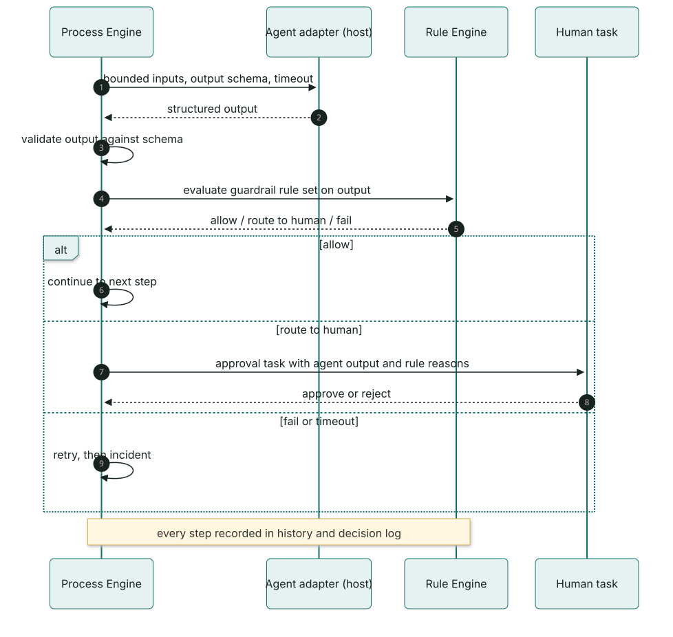

# Process Engine Overview

Planned for milestone 2, including the core of `agentTask`. Milestone 3 adds the MCP adapter, reference LLM adapters and bounded multi-step planning. Stated now so the Rule Engine API fits it.

## Instance lifecycle


## Scope of the first release
| Area | Content |
|---|---|
| Definitions | JSON/YAML, versioned; running instances pin their version |
| Steps | `start`, `end`, `userTask`, `serviceTask`, `agentTask`, `decision` (Rule Engine), `exclusiveGateway`, `parallelGateway`, `timer`, `callProcess` |
| Human tasks | Assign by user, role or group; claim, complete, delegate, reassign; SLA timers and escalation; four-eyes approval enforced by the engine |
| Runtime | State in the host database (`pre_*`); database-backed timers; history of every transition; retry and incidents |
| Reliability | Idempotency keys on start and complete; unique business key per tenant and definition; optimistic locking on tasks and instances |
| Compensation | `compensate` handlers on `serviceTask` and `agentTask`; `saga` blocks; reverse-order execution with retry and incidents |
| SLA | Deadlines computed through a `BusinessCalendar` SPI: working hours, holidays, time zone per tenant |
| Migration | Plan, dry run and batched execution of running instances from one definition version to another |
| Out of scope | Full BPMN 2.0, CMMN, cross-process message correlation (later), distributed job executor, standalone server |

## Idempotency and business keys
```
POST /api/bpm/processes/v1/instances
Idempotency-Key: 7c1e…          # replay returns the same 201 body
{ "definition": "loan-origination", "businessKey": "LN-2027-000123", "variables": { … } }
→ 201 Created, or 200 with the existing instance when the business key already exists for this tenant
```
Task completion carries the task's `version`; a stale completion is answered with `409 CONFLICT`. Java API methods take the same keys as parameters (ADR-0006).

## Compensation


```yaml
- id: reserve-funds
  type: serviceTask
  handler: fundsReservation.reserve
  compensate: fundsReservation.release        # host bean method, must be idempotent
- id: open-account
  type: serviceTask
  handler: coreBanking.openAccount
  compensate: coreBanking.closeAccount
- id: notify-partner
  type: serviceTask
  handler: partnerApi.notify
  compensate: manual                           # raises an incident for operations instead
  onFailure: compensate                        # after retries: run compensations of completed steps in reverse
```
A `saga` block groups steps that compensate together; `throwCompensation` ends a block explicitly. Every compensation is a history row (ADR-0007).

## Business calendar for SLA
```yaml
- id: approve-loan
  type: userTask
  assignee: { role: credit-officer }
  sla: { duration: PT4H, calendar: vn-banking-hours, escalateTo: { role: credit-manager } }
```
```java
public interface BusinessCalendar {
  Instant add(Instant from, Duration businessDuration, String calendarId, String tenantId);
  boolean isBusinessTime(Instant at, String calendarId, String tenantId);
}
```
The default implementation reads weekly hours, holidays and time zone from `pre_calendar` and `pre_holiday`, editable in the cockpit. A 24×7 calendar is built in. Hosts can plug their own.

## Instance migration


```
POST /api/bpm/processes/v1/migrations            # create plan: source v1 → target v2, step mapping
POST /api/bpm/processes/v1/migrations/{id}:validate   # dry run: instances per step, unmapped steps, conflicts
POST /api/bpm/processes/v1/migrations/{id}:execute    # batched; each instance locked, remapped, pinned to v2, history row written
```
Steps with the same id map implicitly; renamed steps need an explicit mapping; removed steps must be mapped or the affected instances cancelled. Instances in incident can be migrated. A failure on one instance raises an incident on that instance; the batch continues.

## The `agentTask` step


```yaml
- id: assess-documents
  type: agentTask
  agent: kyc-document-reviewer           # adapter registered in the host: HTTP, MCP tool or in-process bean
  inputs: { documents: "${instance.documents}", customerType: "${instance.customerType}" }
  outputSchema: schemas/document-assessment.json
  guardrails:
    decision: agent-output-guardrails    # Rule Engine rule set evaluated on the agent's output
    onViolation: route-to-human          # or fail
  timeout: PT5M
  retry: { max: 2, backoff: PT30S }
```
An agent has the same obligations as a service: bounded inputs, a schema for outputs, a timeout, an audit record. The Rule Engine checks the output deterministically; a human approval is required for what the rules flag. The engine never embeds a model.

In engine terms an `agentTask` is a `serviceTask` with an asynchronous adapter, plus two mandatory checks before the process continues: JSON Schema validation of the output, and `RuleEngine.evaluate(guardrailRuleSet, output)`. That is why it ships in milestone 2 with the Process Engine core; milestone 3 adds adapters and planning depth.
