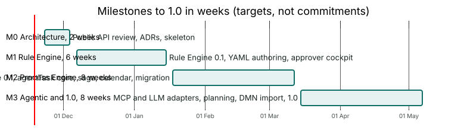

# Roadmap

Design preview: nothing is released. Dates are targets, not commitments; [[Release Notes]] state what shipped.

This page is the short public view. The full plan, with the features in each milestone, the release gates and the assumptions that could change it, is the [product roadmap](https://github.com/dhluong90/horus-Agentic-BPM/blob/main/docs/product/roadmap.md).

## Milestones

| Milestone | Target date | What you can do when it ships |
|---|---|---|
| M0 Architecture | 4 Dec 2026 | Read the decided storage schema, transaction rules and expression grammar, and boot an example host that creates the engine tables in PostgreSQL |
| M1 Rule Engine 0.1, Cockpit 0.1 | 15 Jan 2027 | Evaluate versioned decision tables inside your service's transaction; import rule changes as YAML or JSON, simulate them, and publish them only after a second person approves in the cockpit; look up and explain any past decision |
| M2 Process Engine 0.1 with `agentTask`, Cockpit 0.2 | 12 Mar 2027 | Run approvals with task queues and SLAs, compensating service steps, and AI agent steps whose output must pass a JSON Schema and your guardrail rules; edit tables in a grid; operate instances and incidents in the cockpit |
| M3 Agentic depth, compatibility, 1.0 | 7 May 2027 | Plug in MCP and model adapters from the examples, test a changed prompt or guardrail against recorded traces before it goes live, upgrade without downtime, and build on a frozen API |

## Why this order

| Question | Answer |
|---|---|
| Why rules first | The Rule Engine is useful alone, and `agentTask` guardrails and `decision` steps are rule set evaluations |
| Why `agentTask` in M2 | It is a service step plus schema validation plus a guardrail decision, all available once the Process Engine core and the Rule Engine exist |
| Why the grid editor waits for Cockpit 0.2 | YAML authoring with import and export is enough for a GitOps flow and lets Rule Engine 0.1 ship six weeks earlier |

## Not before 1.0

Message correlation between processes; multi-agent planning; databases other than PostgreSQL; Jakarta EE integration; a hosted cockpit. [[Principles]] states the limits the engines keep at every version.

## Proposing a feature

Open an issue labelled `type:proposal`; see [[Contributing]]. Accepted proposals are recorded as decisions and then move into a milestone.
