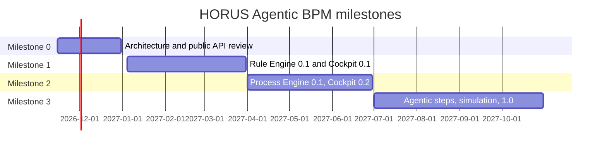

# Product Roadmap

Milestones with target quarters. Targets are intentions, not commitments; the release notes state what shipped. Each milestone has release criteria drawn from the [[Technical Requirements]].

## Milestone 0 — Architecture and public API review (Q4 2026)
Scope: this wiki as the public specification; storage model; expression grammar; module layout; ADRs 0001 to 0005; repository skeleton with CI, licence checks and the example host project.
Exit: specification pages reviewed; ADRs accepted; `examples/rule-engine-only` compiles and starts against PostgreSQL with an empty engine.

## Milestone 1 — Rule Engine 0.1 and Cockpit 0.1 (Q1 2027)
| Area | Deliverables |
|---|---|
| Definitions | Rule sets with typed inputs and outputs; hit policies `first`, `unique`, `collect`; YAML and JSON import and export; validation with row-level messages |
| Expression language | Grammar as documented; literals including money and dates; whitelisted functions; host-registered pure functions |
| Evaluation | Java API, batch evaluation, explicit clock, version pinning; compiled version cache |
| Versioning | Draft, pending approval, published, retired; effective dating; maker-checker in the service layer; diff between versions |
| Decision log | Transactional and async modes; masking; query API; explain endpoint |
| REST | `/api/bpm/rules/v1` as documented, OpenAPI published |
| Cockpit 0.1 | Rule set list, table editor with validation, version diff, approvals, decision log viewer |
| Tooling | `rule-engine-test` with JUnit extension, fixed clock and coverage report |
Release criteria: all TR-EMB, TR-DET, TR-SEC, TR-TEN, TR-OBS-01/02/04, TR-PERF-01/03, TR-QA-01, TR-LIC "must" items green; getting-started guide completed by someone outside the maintainers in under 30 minutes.

## Milestone 2 — Process Engine 0.1 and Cockpit 0.2 (Q2 2027)
| Area | Deliverables |
|---|---|
| Definitions | JSON/YAML process definitions, versioned; nodes `start`, `end`, `userTask`, `serviceTask`, `decision`, `exclusiveGateway`, `parallelGateway`, `timer`, `callProcess` |
| Execution | Instance state machine in the host transaction; database-backed timers across replicas; history; incidents with retry and resolve |
| Human tasks | Assignment by user, role, group; claim, complete, delegate, reassign; SLA timers and escalation; four-eyes approval task |
| REST | `/api/bpm/processes/v1` |
| Cockpit 0.2 | Definitions, instances with current step, task queues, incidents, history timeline |
Release criteria: TR-PERF-04/05, TR-OPS-03 and all "must" items green; `examples/both` shows a process using a decision step.

## Milestone 3 — Agentic steps, simulation, 1.0 (Q3–Q4 2027)
| Area | Deliverables |
|---|---|
| Agentic | `agentTask` with adapter SPI (HTTP, MCP tool, in-process), output schema validation, guardrail rule set, route-to-human on violation, timeouts and retries; reference adapters for common LLM APIs living in `examples/` |
| Simulation | Rule Engine simulation against sample inputs and against decision history, attached to publish requests |
| Operations | Partitioning, zero-downtime upgrade tests, OpenTelemetry spans, explain templates |
| Compatibility | DMN decision-table import; BPMN subset import for the supported node types |
| 1.0 | API freeze for the major version; deprecation policy in force; documentation site generated from the wiki |
Release criteria: every "must" requirement green; two adopters outside the maintainers in production or pilot.

## Beyond 1.0 (candidates, not planned)
Message correlation between processes; additional databases through the storage SPI; Jakarta EE integration; a hosted cockpit; multi-agent planning with ad-hoc step selection.

## How the roadmap changes
Proposals are issues labelled `type:proposal`. Accepted proposals become ADRs and move into a milestone. This page is updated in the same pull request.
