# Decision API

Reference for the two Rule Engine surfaces: the in-process Java API and the optional REST API under `/api/bpm/rules/v1` that the cockpit and remote callers use. _Design preview: the contract is reviewed here before the code exists._



## Java

```java
public interface RuleEngine {
  DecisionResult evaluate(String ruleSet, DecisionInput input);
  DecisionResult evaluate(String ruleSet, int version, DecisionInput input);   // pin a version
  DecisionResult evaluate(DecisionRequest request);                            // tenant, clock, correlation id, caller, idempotency key
  <T> T evaluateAs(String ruleSet, DecisionInput input, Class<T> outputType);  // map outputs onto a record
}
```
```java
DecisionResult r = rules.evaluate("card-fee", DecisionInput.of("tier", "GOLD", "balance", Money.of("VND", 60_000_000), "txCount", 3));
r.ruleSet();            // "card-fee"
r.version();            // 2
r.matchedRuleIds();     // ["R2"]
r.output("fee", Money.class);
r.decisionId();         // ULID of the decision log row
r.isError();            // false
```

| Rule | Detail |
|---|---|
| Tenant and caller | From the host's `TenantResolver` and `CallerResolver` (defaults read Spring Security). `DecisionRequest.tenantId` is for batch jobs that run without a security context and requires the host to grant it explicitly |
| Clock | `DecisionRequest.clock` selects the effective version and feeds `today()` and `now()`; default is the engine `Clock` bean |
| Errors | `DecisionResult.isError()` with `errorCode()`; the Java API throws only for programming errors (unknown rule set, invalid input shape) |
| Idempotency | `DecisionRequest.idempotencyKey` returns the stored decision instead of logging a second one (ADR-0006) |

## REST conventions

| Convention | Rule |
|---|---|
| Base path | `/api/bpm/rules/v1` (`rest.base-path`, keep the version segment when you change it). Breaking changes go to `/v2`; additive fields stay in `/v1` |
| Actions | Non-CRUD transitions use a `:verb` suffix: `:evaluate`, `:request-publish`, `:approve` |
| Identifiers | ULID strings, for example `01JD2X5K9T1Q4N8V2M7B3C6D0E` |
| Timestamps | ISO 8601 UTC, `2026-12-01T00:00:00Z` |
| Money | `{ "currency": "VND", "amount": 60000000 }`: ISO 4217 code and an integer in minor units. Never a JSON float |
| Tenant | Resolved from the security context or a trusted gateway header. A `tenantId` field in any request body is ignored (`TR-SEC-03`, `RLE-011`) |
| Authentication | Every endpoint requires an authenticated principal from the host's Spring Security; see [[Multi Tenancy and Security]] |
| Errors | RFC 9457 `application/problem+json` with a stable `code`; see the error matrix |
| Idempotency | `Idempotency-Key` header on every `POST` and `PUT`; semantics below |
| Optimistic locking | Drafts carry `version` (entity lock version). `PUT` requires `If-Match: "<version>"` or the `version` field; responses carry `ETag` |
| Pagination | Cursor-based: `?cursor=<opaque>&limit=50` (max 200), response `{ "data": [], "nextCursor": "...", "hasNext": true }` |
| OpenAPI | `GET /api/bpm/rules/v1/openapi.yaml` (OpenAPI 3.1) |
| Expressions in definitions | Plain function form only: `startsWith(name, 'Mr')`, `len(s)`, `matches(s, '^[A-Z]')`. There is no method-call syntax (`name.startsWith('Mr')`), which keeps the grammar closed (ADR-0003) |

## Endpoints

| Method and path | Purpose | Permission | Headers |
|---|---|---|---|
| `POST /decisions/{ruleSet}:evaluate` | Evaluate the effective version at `clock` (default now) | `rules:evaluate`; `rules:simulate` when `clock` is set | `Idempotency-Key` optional |
| `POST /decisions/{ruleSet}/versions/{v}:evaluate` | Evaluate a specific version; drafts allowed for simulation | `rules:evaluate` for published versions; `rules:simulate` for drafts or a custom `clock` | `Idempotency-Key` optional |
| `POST /decisions/{ruleSet}:evaluate-batch` | Up to 1 000 input sets; one decision row each; partial failures reported per item | `rules:evaluate` | `Idempotency-Key` optional |
| `GET /rule-sets` | List rule sets with effective version and pending approvals | `rules:read` | cursor pagination |
| `GET /rule-sets/{name}` | Rule set with its versions and states | `rules:read` | |
| `GET /rule-sets/{name}/versions/{v}` | One version, canonical JSON, validation report | `rules:read` | `ETag` |
| `GET /rule-sets/{name}/versions/{a}/diff/{b}` | Added, removed and changed rows and columns | `rules:read` | |
| `POST /rule-sets` | Create a rule set with an initial draft | `rules:author` | `Idempotency-Key` |
| `POST /rule-sets/{name}/versions` | New draft, empty or copied from a version | `rules:author` | `Idempotency-Key` |
| `PUT /rule-sets/{name}/versions/{v}` | Replace a draft's content | `rules:author` | `If-Match` |
| `POST /rule-sets/{name}/versions/{v}:validate` | Parse and type-check without saving | `rules:author` | |
| `POST /rule-sets/{name}/versions/{v}:simulate` | Evaluate a draft over sample inputs or logged decisions; writes no decision rows | `rules:simulate` | `Idempotency-Key` |
| `POST /rule-sets/{name}/versions/{v}:request-publish` | Freeze the draft, record the requester | `rules:author` | `Idempotency-Key`, `If-Match` |
| `POST /rule-sets/{name}/versions/{v}:approve` | Publish; approver must differ from requester | `rules:approve` | `Idempotency-Key`, `If-Match` |
| `POST /rule-sets/{name}/versions/{v}:reject` | Back to draft with a reason | `rules:approve` | `Idempotency-Key`, `If-Match` |
| `POST /rule-sets/{name}/versions/{v}:retire` | Retire a published version | `rules:approve` | `Idempotency-Key`, `If-Match` |
| `GET /rule-sets/{name}/versions/{v}/export` | YAML export | `rules:read` | |
| `POST /rule-sets/{name}/versions:import` | Create a draft from YAML or JSON | `rules:author` | `Idempotency-Key` |
| `GET /decisions/{id}` | One decision; masked inputs stay hashed | `rules:log:read` | |
| `GET /decisions/{id}/explain` | Plain-language explanation | `rules:log:read` | |
| `GET /decisions?ruleSet=&from=&to=&outcome=&matchedRuleId=&cursor=&limit=` | Decision log, newest first | `rules:log:read` | cursor pagination |

Permission strings match [[Rule Engine Configuration]].

## Evaluate

Request:
```json
{ "inputs": { "tier": "GOLD", "balance": { "currency": "VND", "amount": 60000000 }, "txCount": 3 },
  "correlationId": "acct-open-7781", "clock": "2026-12-01T00:00:00Z" }
```
Response `200 OK`:
```json
{ "decisionId": "01JD2X5K9T1Q4N8V2M7B3C6D0E", "ruleSet": "card-fee", "version": 2, "hitPolicy": "first",
  "outputs": { "fee": { "currency": "VND", "amount": 0 }, "waived": true },
  "matchedRuleIds": ["R2"], "clock": "2026-12-01T00:00:00Z", "evaluatedAt": "2026-11-18T09:12:44Z", "durationMicros": 180 }
```
`clock` is the instant the decision reasoned about; `evaluatedAt` is when it ran. Both are logged so the decision replays (`TR-DET-05`).

Batch request and response wrap items in `{ "items": [ { "inputs": {}, "correlationId": "" } ] }` and `{ "results": [ { "index": 0, "decision": {} } | { "index": 1, "problem": {} } ] }`.

## Export, import and diff

| Call | Request | Response |
|---|---|---|
| `GET /rule-sets/{name}/versions/{v}/export` | `Accept: application/yaml` (default) or `application/json` | `200` with the canonical definition document, `ETag: "<version>"`, `Content-Disposition: attachment; filename="card-fee-v2.yaml"` |
| `POST /rule-sets/{name}/versions:import` | `Content-Type: application/yaml` or `application/json`; body is a definition document; `Idempotency-Key` | `201` with the new draft `{ "ruleSet": "card-fee", "version": 3, "status": "DRAFT", "lockVersion": 0, "validation": { "errors": [], "warnings": [] } }`; `422 VALIDATION_FAILED` when the document does not parse; the rule set is created when `{name}` does not exist and the caller has `rules:author` |
| `GET /rule-sets/{name}/versions/{a}/diff/{b}` | none | `200` `{ "from": 1, "to": 2, "hitPolicyChanged": false, "columns": { "added": [], "removed": [], "changed": [] }, "rows": { "added": ["R5"], "removed": [], "changed": [ { "ruleId": "R2", "cells": [ { "column": "fee", "from": {"currency":"VND","amount":10000}, "to": {"currency":"VND","amount":0} } ] } ] } }` |

Definition documents carry `schemaVersion`; old schema versions import forever. Simulation of a draft (`:simulate`) uses the same evaluator as `:evaluate` and writes no decision rows:



## Idempotency-Key semantics

The engine stores `(tenant_id, operation, idempotency_key, request_hash, status, body)` in `rle_idempotency` for 24 hours (`idempotency.retention`).

| Situation | Response |
|---|---|
| New key | Request executes; status and body stored |
| Same key, same request hash, finished | The original status and body, for example `201`; no second effect |
| Same key, different request hash | `422 IDEMPOTENCY_KEY_REUSE_MISMATCH` |
| Same key, first request still in flight | `409 IDEMPOTENCY_IN_FLIGHT` with `Retry-After: 1` |
| Key older than the retention window | Treated as new |

On `:evaluate` the key is optional. Evaluation is pure, so a retry without a key is safe; it only logs a second decision. With a key, the stored decision is returned and no second row is written (`RLE-014`).

## Optimistic locking

Every draft response carries `version` in the body and `ETag: "<version>"`. `PUT` and lifecycle actions require `If-Match` (or `version` in the body). The update runs as `UPDATE ... WHERE lock_version = :expected`; zero rows updated gives `409 VERSION_CONFLICT` with the current version in `detail`. Approvals also carry the lock, so a second approval of the same version is rejected rather than replayed.

## Error shape

```json
{
  "type": "https://github.com/horus-bpm/errors/unique-hit-violation",
  "title": "Unique hit policy violated",
  "status": 409,
  "code": "UNIQUE_HIT_VIOLATION",
  "detail": "Rule set 'card-fee' v2 matched 2 rules (R2, R4); expected exactly 1.",
  "instance": "/api/bpm/rules/v1/decisions/card-fee:evaluate",
  "correlationId": "acct-open-7781",
  "violations": []
}
```
`violations` lists `{ "field", "ruleId", "message" }` entries for validation errors. Responses never contain stack traces. `500` responses carry only `code: INTERNAL_ERROR` and the `correlationId` to find the server log.

## Error code matrix

| HTTP | `code` | When | Endpoints |
|---|---|---|---|
| 400 | `INPUT_INVALID` | Missing or mistyped input, malformed JSON, `limit` above 200 | all |
| 401 | `UNAUTHENTICATED` | No principal | all |
| 403 | `PERMISSION_DENIED` | Principal lacks the permission | all |
| 403 | `SELF_APPROVAL_FORBIDDEN` | Approver equals requester (`TR-SEC-04`) | `:approve` |
| 403 | `CLOCK_NOT_ALLOWED` | `clock` set without `rules:simulate` | `:evaluate` |
| 404 | `RULE_SET_NOT_FOUND` | Unknown rule set in this tenant (also for other tenants' rule sets) | all with `{ruleSet}` or `{name}` |
| 404 | `VERSION_NOT_FOUND` | Unknown version number | versions |
| 404 | `NO_EFFECTIVE_VERSION` | Nothing published and effective at `clock` | `:evaluate`, `:evaluate-batch` |
| 404 | `DECISION_NOT_FOUND` | Unknown or other-tenant decision id | `/decisions/{id}` |
| 409 | `UNIQUE_HIT_VIOLATION` | `unique` table matched zero or several rows (`TR-DET-04`) | `:evaluate` |
| 409 | `VERSION_CONFLICT` | `If-Match` or `version` is stale | `PUT`, lifecycle actions |
| 409 | `INVALID_STATE` | Action not allowed in the current state, for example `:approve` on a `DRAFT` | lifecycle actions |
| 409 | `IDEMPOTENCY_IN_FLIGHT` | Same key, first request still running; `Retry-After: 1` | all with `Idempotency-Key` |
| 409 | `RULE_SET_EXISTS` | Name already used in this tenant | `POST /rule-sets` |
| 422 | `VALIDATION_FAILED` | Parse or type errors; `violations` lists rows (`TR-DET-02`) | `PUT`, `:validate`, `:request-publish`, `:import` |
| 422 | `EVALUATION_ERROR` | Currency mismatch, division by zero, regex timeout; `detail` names the reason (`CURRENCY_MISMATCH`, `DIVISION_BY_ZERO`, `REGEX_TIMEOUT`, `FUNCTION_ERROR`) | `:evaluate` |
| 422 | `IDEMPOTENCY_KEY_REUSE_MISMATCH` | Same key, different payload | all with `Idempotency-Key` |
| 422 | `BATCH_TOO_LARGE` | More than 1 000 items | `:evaluate-batch` |
| 429 | `RATE_LIMITED` | Host rate limiter, if configured; `Retry-After` | all |
| 500 | `INTERNAL_ERROR` | Unexpected failure; no details beyond `correlationId` | all |

Decision rows record `outcome` as `OK`, `UNIQUE_HIT_VIOLATION` or `EVALUATION_ERROR`, so errors are auditable too.

## Events

| `eventType` | When | Payload |
|---|---|---|
| `rules.version.publish-requested.v1` | `:request-publish` | `ruleSet`, `version`, `requestedBy` |
| `rules.version.published.v1` | `:approve` | `ruleSet`, `version`, `effectiveFrom`, `approvedBy`, `requestedBy` |
| `rules.version.rejected.v1` | `:reject` | `ruleSet`, `version`, `reason` |
| `rules.version.retired.v1` | `:retire` or superseded | `ruleSet`, `version` |
| `rules.decision.evaluated.v1` | every decision, off by default (`events.decision-evaluated`) | `decisionId`, `ruleSet`, `version`, `outcome` |

Envelope: `eventId` (ULID), `eventType`, `occurredAt`, `tenantId`, `correlationId`, `causationId`, `producer`, `schemaVersion`, `payload`. Changes are additive within a `.v1` type. Events go through the host's `RuleEventPublisher` inside the same transaction as the state change.

## Performance targets (0.1)

In-process evaluation of a 200-row `first` table: p99 under 100 us after warm-up (`TR-PERF-01`). The transactional decision log adds exactly one `INSERT` (`TR-PERF-03`). REST `:evaluate` p99 target: 10 ms in the same data centre. Targets, not measurements, until the M1 benchmarks publish.
