# Versioning and Publishing

Business users change rules without a deployment; the engine keeps it safe. _Design preview._

## States

- **draft**: editable; evaluable only through simulation.
- **pending approval**: frozen; waits for a second identity.
- **published**: immutable; effective from `effectiveFrom` (default: approval time). At most one published version is effective per tenant at a time; a future-dated version is scheduled and becomes effective automatically.
- **retired**: no longer effective; still readable, still able to explain old decisions.

## Maker-checker
The identity that requested publication cannot approve it. The check is in the engine (`VersionService`), not only in the cockpit, so it also holds for API callers. Approval records approver, time and an optional comment, and emits an `rules.version.published` event for the host's audit system.

## Effective dating
Set `effectiveFrom` to schedule a change (for example a fee change from the first of next month). The scheduler is the engine's own database-backed timer; no external job runner is needed. A decision logs the version that was effective at its `clock`.

## Rollback
Publishing a new version from the retired version's content (the cockpit has "Restore as draft"). History is never rewritten.

## Per-tenant overrides
A rule set is defined per tenant. A shared default can be copied into a tenant ("Fork from tenant default") and then diverge. There is no inheritance at evaluation time; this keeps evaluation deterministic and explainable.

## Diffing versions
`GET /rule-sets/{name}/versions/{a}/diff/{b}` returns added, removed and changed rows and columns; the cockpit renders it side by side. Use with [[Rule Engine Simulation and Testing]] before approving.
