# Technical Stack

Chosen for small footprint, long support and permissive licences. Decisions are ADRs in the repository (`docs/adr/`).

## Engines
| Area | Choice | Rejected, and why |
|---|---|---|
| Language | Java 21 baseline, Java 25 in CI | Kotlin: a runtime in every host |
| Integration | Spring Boot 3.4+ starters; `core` is framework-free | Quarkus, Micronaut, Jakarta EE: later if asked |
| Data access | Spring JDBC `JdbcClient` | JPA/Hibernate: hidden queries and entity lifecycle inside a library; jOOQ: code generation and dual licence |
| Database | PostgreSQL 14+ behind a storage SPI | Multi-database in 0.x: doubles the matrix before the design is proven |
| Migrations | Flyway community edition, one history table per engine | Liquibase: heavier |
| JSON | Jackson | Already in every Spring host |
| Expression language | Hand-written recursive-descent parser, typed tree, zero dependencies | ANTLR: fine licence, more machinery than the grammar needs; SpEL, MVEL, JEXL: allow method calls and reflection |
| Identifiers | ULID | UUIDv4: index churn; sequences: not replica-safe |
| Observability | Micrometer; OpenTelemetry API optional | Vendor SDKs |
| Scheduling | Database timers with `SKIP LOCKED`, one scheduler thread per host instance | Quartz: own tables and clustering; brokers: a new dependency |
| Testing | JUnit 5, AssertJ, Testcontainers, jqwik, ArchUnit, JMH | Mockito for the evaluator: pure functions need no mocks |
| Build and supply chain | Maven reactors plus `bpm-bom`; Error Prone, Checkstyle, SpotBugs, Dependency-Check, CycloneDX SBOM, licence allowlist | Gradle: fine, Maven's rigidity suits a library |

## Cockpit
| Area | Choice |
|---|---|
| UI | React 18, TypeScript 5, Vite |
| Data | TanStack Query and Table |
| Forms | React Hook Form, Zod schemas generated from OpenAPI |
| Styling | CSS variables, small internal component set, light and dark |
| Testing | Vitest, Testing Library, Playwright against an example host |
| Packaging | Jar served by `cockpit-spring-boot-starter`, and a plain archive for standalone hosting |

## Delivery
| Area | Choice |
|---|---|
| CI | GitHub Actions: Java 21/25 × PostgreSQL 14/16/17, ArchUnit, benchmark trend, SBOM, licence check, wiki publish |
| Versioning | Semver per module; tags `<module>/vX.Y.Z`; `bpm-bom` with every release |
| Distribution | Maven Central via the Sonatype Central Portal |

## Open decisions
- **Maven groupId.** `com.horus.bpm` needs verified ownership of `horus.com`; otherwise a domain the project controls, or `io.github.<owner>.bpm`. Decided before the first published artifact.
- **Java 25 as baseline** once host adoption allows.
